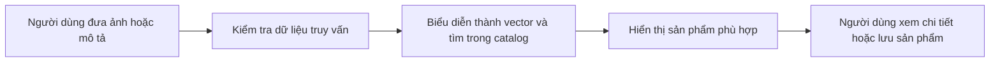
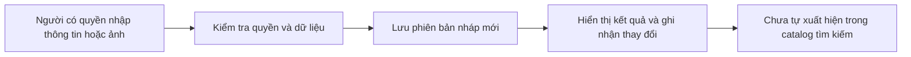
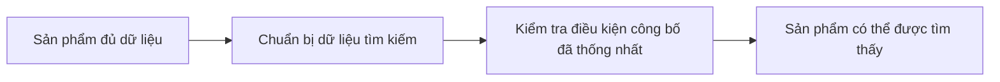

# Flow nghiệp vụ để nhóm cùng đối chiếu

Bản thảo thảo luận ngày 09/10/2026. Chưa coi là đã được cô hoặc cả nhóm duyệt. Dựa trên đề cương gốc và source hiện tại, không thêm nghiệp vụ từ sơ đồ agent.

| Mục tiêu | Ai làm, đưa gì vào? | Các bước chính và kết quả | Hiện trạng / điều cần chốt |
| --- | --- | --- | --- |
| Tìm sản phẩm bằng ảnh | Người dùng đưa ảnh truy vấn | Biểu diễn ảnh, tìm và xếp hạng, hiển thị sản phẩm thật | Pilot chạy được; không tự lấy Draft mới vào search. |
| Tìm bằng mô tả | Người dùng nhập mô tả tự nhiên | Biểu diễn câu, tìm và hiển thị Top-K | Có luồng thật; chất lượng tiếng Việt cần đánh giá riêng. |
| Tìm bằng ảnh và mô tả thay đổi | Người dùng đưa ảnh hoặc reference hợp lệ cùng text | Kết hợp embedding, xếp hạng và hiển thị | Có luồng thật; giải thích mục tiêu trước thuật ngữ fusion. |
| Quản lý sản phẩm | Người có quyền nhập metadata/ảnh | Kiểm tra, tạo/sửa và xem sản phẩm nháp | Draft đã có; phân vai và điều kiện công bố cần thống nhất. |
| Đưa sản phẩm mới vào search | Người có quyền muốn công bố sản phẩm | Chuẩn bị dữ liệu tìm kiếm, kiểm tra điều kiện, cho phép tìm thấy | Chưa có đường đi hoàn chỉnh trong source hiện tại. |
| Quản lý tài khoản/dữ liệu riêng | Người đã đăng ký | Profile, mật khẩu, Saved và History | Đã implement; “chọn/hủy chọn” chưa được tự coi là Saved. |
| Đánh giá hệ thống | Nhóm làm đồ án | Query có ground truth, metrics, latency và báo cáo | Engineering/parity không thay Precision@K/Recall@K cuối. |

## Search — luồng thực tế

Login là điều kiện của dữ liệu cá nhân, không phải yêu cầu bắt buộc để Guest tìm bằng ảnh. Timeout, CSRF và model/version guards cần được giải thích ở thiết kế kỹ thuật hoặc luồng lỗi, không nhét tất cả thành nghiệp vụ chính.

## Quản lý sản phẩm — checkpoint Draft đã implement

Câu cần trả lời cùng nhau: sau khi lưu Draft, ai quyết định nó được công khai, khi nào và nếu chuẩn bị ảnh/vector thất bại thì làm gì? Source hiện tại chưa cung cấp đầy đủ câu trả lời bằng implementation.

## Đưa sản phẩm vào catalog — mục tiêu còn phải thống nhất

Sơ đồ thứ ba là mục tiêu thảo luận, không phải claim đã implement hoặc đã được cô duyệt. Processing/review/publication là cơ chế thiết kế của repo, không phải tất cả các tên chức năng được đề cương quy định nguyên văn.

## Nhóm cần giải thích được

Mỗi chức năng: ai cần gì; input; các bước chính; kết quả; trường hợp sai/quyền/lỗi; phần đã làm và chưa làm; điểm bắt đầu trong source; người chịu trách nhiệm. Nêu căn cứ đề cương/decision hoặc đánh dấu lựa chọn còn mở. Số test PASS không thay thế phần giải thích này.
