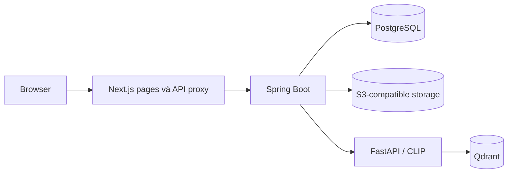

# FaSearch

FaSearch là website tìm kiếm sản phẩm thời trang bằng hình ảnh, mô tả ngôn ngữ tự nhiên hoặc kết hợp cả hai. Dự án thuộc đề tài CNTT-KLCN198 và gồm giao diện người dùng, backend nghiệp vụ, dịch vụ AI nội bộ cùng các thành phần lưu trữ và đánh giá.

README này là điểm bắt đầu để thành viên nhóm hiểu hệ thống, tìm code và chuẩn bị môi trường. Trạng thái dưới đây phản ánh bản source tích hợp hiện tại; không mặc định toàn bộ nghiệp vụ đã được duyệt hoặc hệ thống đã sẵn sàng triển khai thực tế.

## 1. Phạm vi và trạng thái

| Nhóm chức năng | Đã có trong source | Ranh giới hiện tại |
| --- | --- | --- |
| Tìm kiếm | IMAGE, TEXT, COMPOSED; Top-K; reference từ ảnh upload hoặc sản phẩm; thông tin và ảnh kết quả | Dùng model pretrained và catalog pilot cố định; chất lượng tiếng Việt cần đánh giá riêng. |
| Catalog công khai | Danh sách, filter theo category, pagination, chi tiết và entry vào composed search | Đọc snapshot đã chuẩn bị; chưa tự lấy sản phẩm mới từ Draft vào search. |
| Tài khoản | Đăng ký, đăng nhập/đăng xuất, profile, đổi mật khẩu và session revocation | Dùng session server-side; chưa có toàn bộ UI quản trị tài khoản/role. |
| Dữ liệu cá nhân | Saved products; history có consent, xem/xóa và giới hạn lưu giữ | Người dùng chỉ truy cập dữ liệu của mình; ảnh truy vấn không được giữ trong history. |
| Vận hành catalog | Draft create/edit, primary image, version conflict, version timeline/compare, audit và danh sách có filter | Draft vẫn là Draft; chưa có đường hoàn chỉnh processing → review → publication/ACTIVE. |
| API và kiểm chứng | Public/internal OpenAPI; unit/integration/contract tests và các script kiểm chứng | Test và demo local không thay thế final metrics, deployment hoặc xác nhận nghiệp vụ của nhóm/GVHD. |

Các chức năng thanh toán, giỏ hàng, vận chuyển, đơn hàng và loyalty không thuộc scope tìm kiếm cốt lõi hiện tại. Chưa triển khai fine-tuning trong bản ứng dụng này. “Chọn/hủy chọn kết quả” cần được thống nhất riêng; không mặc định đồng nghĩa với Saved Product.

## 2. Kiến trúc



- **Next.js/TypeScript:** giao diện, state tương tác và same-origin proxy. Browser không gọi trực tiếp AI server hoặc database.
- **Spring Boot/Java:** API công khai, tài khoản/session, quyền, catalog, Saved/History, audit và điều phối search. Backend nghiệp vụ được build thành một ứng dụng; các nhóm chức năng nằm trong cùng ứng dụng này.
- **FastAPI/Python/PyTorch:** API AI nội bộ, xử lý ảnh/text, tạo embedding và truy vấn vector. Dịch vụ chạy riêng để sử dụng runtime Python; không sở hữu tài khoản, quyền hoặc history của website.
- **PostgreSQL:** account, role/permission, session, Draft/version, metadata ảnh, Saved/History và audit.
- **S3-compatible storage:** bytes ảnh sản phẩm Draft. Response cho browser không trả storage key hoặc credential.
- **Qdrant:** serving vector của candidate hiện tại. **FAISS:** baseline nghiên cứu, parity/reference và rollback được thực hiện có chủ đích; không phải fallback ngầm khi Qdrant lỗi.

“Vertical slice” mô tả cách phát triển hoặc nhóm code theo một chức năng/use case. “Monolith” mô tả đơn vị build/deploy. Một backend deploy chung vẫn có thể chia thành các module theo chức năng. Source hiện tại chia theo nhóm nghiệp vụ và có thêm các tầng xử lý trong search; không coi tên pattern là bằng chứng rằng mọi package đều cần giữ nguyên.

## 3. Các luồng chính

### Tìm kiếm sản phẩm

1. Người dùng chọn ảnh, nhập mô tả hoặc kết hợp ảnh và text.
2. Next.js chuyển request tới API Spring Boot.
3. Backend kiểm tra request và xác định catalog/model/index tương thích.
4. AI tạo embedding và truy vấn Qdrant theo mode yêu cầu.
5. Backend kiểm tra response, ghép ranked IDs với metadata catalog rồi trả kết quả cho UI.
6. History chỉ được ghi khi có consent, session và điều kiện bảo vệ phù hợp. Guest vẫn tìm bằng ảnh được.

Ảnh/input không hợp lệ phải được trả như lỗi dữ liệu; dịch vụ AI không sẵn sàng phải được trả như lỗi dịch vụ. Không tự chuyển provider để che lỗi. Similarity score không phải xác suất hay confidence đã hiệu chuẩn.

### Quản lý Draft

1. Người có quyền tạo Draft hoặc mở Draft được phép truy cập.
2. Sửa metadata hoặc thay primary image tạo Product Version mới; phiên bản cũ giữ nguyên.
3. Request gửi version đang sửa. Nếu có người/tab khác sửa trước, backend trả `409 VERSION_CONFLICT`.
4. UI giữ nội dung đang nhập, cho xem bản mới và resubmit sau quyết định của người dùng; không tự ghi đè.
5. Các thay đổi được ghi audit trong transaction. Timeline và ảnh historical chỉ được đọc theo đúng product/version và quyền.

**Lưu Draft chưa làm sản phẩm searchable.** Cơ chế chuẩn bị embedding, review và công bố dữ liệu mới cần được hoàn thiện theo nghiệp vụ nhóm thống nhất.

### Tài khoản và dữ liệu cá nhân

Backend sở hữu session JDBC; browser giữ cookie opaque `HttpOnly`, không lưu access/refresh token. Request ghi dùng CSRF theo contract. Saved và History được giới hạn theo account. Đổi mật khẩu thu hồi các session cũ theo cơ chế hiện có.

## 4. Cấu trúc source và đường đọc

```text
fe/                         Website Next.js
  src/app/                  Pages, routes và API proxy
  src/components/           Form, workbench và các phần giao diện
  src/lib/                  Contract/state/proxy helpers
  tests/                    Kiểm thử frontend
be/                         Một ứng dụng Spring Boot
  src/main/java/.../
    identity/               Tài khoản, session, profile, mật khẩu, quyền
    catalog/                Draft, ảnh, version và console operations
    library/                Saved, History và consent/retention
    search/                 Search API, xử lý nghiệp vụ, HTTP/catalog adapters
  src/main/resources/       Cấu hình, Flyway và served OpenAPI
  src/test/                 Kiểm thử backend
ai/
  src/                      Serving Qdrant hiện tại
  ml/retrieval/             Core nghiên cứu embedding/fusion/FAISS
  fasearch_ai/              Adapter FAISS/reference/rollback
  configs/                  Model, serving và frozen-publication configuration
  tests/                    Kiểm thử AI/research/contracts
contracts/                  OpenAPI public và internal
schemas/                    Schema dữ liệu/nghiên cứu
infra/fasearch/             Docker Compose và runtime dùng chung
docs/                       Phân tích, quyết định, kiến trúc và tài liệu
tools/                      Script đánh giá, vận hành và kiểm chứng
data/, artifacts/           Dữ liệu/model/index local, phần lớn không trong Git
```

Đọc theo một chức năng, không cần đọc mọi thư mục trước:

| Muốn xem gì? | Điểm bắt đầu |
| --- | --- |
| Tìm bằng ảnh | `fe/src/components/image-search-workbench.tsx` → proxy → `ImageSearchController` → `ImageSearchModule` → `HttpAiImageSearchAdapter` → `ai/src/api/endpoints.py` → `search_service.py`. |
| Tìm bằng chữ/composed | Các workbench tương ứng trong `fe/src/components`, controller/module/adapter tương ứng trong `be/.../search`, internal endpoints và service Python. |
| Tạo/sửa Draft | `catalog-draft-form.tsx` → `CatalogDraftController`/`CatalogDraftImageController` → `CatalogDraftModule`/`CatalogImageModule`. |
| Timeline/audit | `catalog-version-history.tsx`/`catalog-audit-trail.tsx` → `CatalogDraftOperationsController`/`CatalogDraftOperations`. |
| Tài khoản | FE auth/account forms → Spring Security và `AccountController`/`AccountModule`. |
| Saved/History | FE account/library pages → `LibraryController`/`LibraryModule`. |

Trong backend search, `api` nhận/trả HTTP; `application` xử lý request nghiệp vụ; `infrastructure` gọi AI hoặc đọc catalog. `UseCase` mô tả interface, `Module` thực hiện xử lý, `Port` mô tả khả năng bên ngoài và `Adapter` kết nối tới implementation thực.

## 5. Yêu cầu môi trường và dữ liệu

- Java 17; Maven Wrapper trong `be/`.
- Python **3.12** theo `ai/pyproject.toml`; môi trường riêng, dependencies pinned.
- Node.js tương thích với version Next.js trong `fe/package.json`; cài bằng `npm ci` với lockfile.
- Docker và Docker Compose cho PostgreSQL, object storage và Qdrant. Một số BE integration tests dùng Testcontainers.
- Bộ frozen artifacts và model cache tương thích. Không chỉ clone Git rồi giả định đã có ảnh, embeddings hoặc model.

Candidate hiện dùng 600 sản phẩm pilot, vector 512 chiều, CLIP `openai/clip-vit-base-patch32` với revision đã pin và Qdrant exact DOT trên vector chuẩn hóa. Đây là dữ liệu engineering pilot, không phải final benchmark tiếng Việt.

`ai/configs/web.v1.yaml` xác định catalog, model, input artifacts và collection. Chuẩn bị các file đúng manifest/hash trong `data/` và `artifacts/`, cùng cached model đúng revision, trước khi bật serving. Nếu chưa có bộ dữ liệu/artifacts được nhóm thống nhất, chỉ có thể chạy các test/fixture tương ứng; không claim demo đầy đủ.

## 6. Chuẩn bị hạ tầng local

Từ root repository, tạo cấu hình local từ example, điền password và chọn volume names phù hợp:

```bash
cp infra/fasearch/.env.example infra/fasearch/.env
chmod 600 infra/fasearch/.env
```

Các volumes trong Compose là external. Trên máy mới, tạo chúng trước khi chạy; trên máy đã có runtime, giữ đúng tên volumes đang dùng. Theo example mặc định:

```bash
docker volume create fasearch-postgres-data
docker volume create fasearch-storage-data
docker volume create fasearch-qdrant-data
bash infra/fasearch/manage.sh up -d postgres storage
bash infra/fasearch/manage.sh --profile shadow up -d qdrant
```

Tên profile `shadow` là tên cấu hình hiện có, không có nghĩa mọi request đang chạy shadow mode. Các cổng mặc định trên host là PostgreSQL `55732`, storage `38535`, Qdrant REST/gRPC `16333/16334`.

Database và bucket ứng dụng phải tồn tại và thuộc môi trường được phân công. Khi nhiều người dùng cùng hạ tầng, phối hợp database/bucket/process ownership; không reset dữ liệu hoặc volumes của người khác.

## 7. Cấu hình và chạy ứng dụng

Ví dụ dưới dùng FE `3000`, BE `8080`, AI `8001`; có thể đổi đồng bộ nếu cổng đã dùng. Mỗi terminal bắt đầu tại root repo. Các secret lấy từ môi trường hoặc file local được ignore và đặt quyền phù hợp; không ghi giá trị vào source, README hoặc command được chia sẻ.

### AI: chuẩn bị môi trường và collection

```bash
python3.12 -m venv .venv
.venv/bin/python -m pip install -r ai/requirements-cpu.lock
.venv/bin/python -m pip check

export FASEARCH_REPO_ROOT="$PWD"
export FASEARCH_SHADOW_CONFIG="$PWD/ai/configs/web.v1.yaml"
export HF_HUB_OFFLINE=1
export TRANSFORMERS_OFFLINE=1

.venv/bin/python ai/scripts/ingest_shadow.py \
  --repo-root "$FASEARCH_REPO_ROOT" \
  --config "$FASEARCH_SHADOW_CONFIG" --dry-run
```

Dry-run kiểm tra input trước khi ingest. Khi collection được xác nhận thuộc môi trường này, dùng cùng lệnh bỏ `--dry-run` để ingest dữ liệu frozen. Không dùng `--reset` hoặc thao tác trên collection lạ. Model cache phải được chuẩn bị trước; nếu cache ở vị trí khác mặc định thì đặt `HF_HOME` tương ứng.

```bash
REPO_ROOT="$PWD"
cd ai
"$REPO_ROOT/.venv/bin/python" -m uvicorn src.main:app \
  --host 127.0.0.1 --port 8001
```

Các tên biến `FASEARCH_SHADOW_CONFIG` và script `ingest_shadow.py` được giữ để tương thích; cấu hình `web.v1.yaml` chọn Qdrant serving của website. Health: `http://127.0.0.1:8001/internal/v1/health`; readiness: `http://127.0.0.1:8001/ready`. Chỉ tiếp tục search demo khi model và collection ready.

### Backend: cấu hình môi trường

Các biến cần kiểm tra trước khi khởi động:

| Nhóm | Biến |
| --- | --- |
| Database | `FASEARCH_DB_URL`, `FASEARCH_DB_USER`, `FASEARCH_DB_PASSWORD` |
| Storage | `FASEARCH_OBJECT_ENDPOINT`, `FASEARCH_OBJECT_BUCKET`, `FASEARCH_OBJECT_REGION`, credential theo provider |
| AI | `FASEARCH_AI_BASE_URL` |
| Catalog và publication | `FASEARCH_CATALOG_FILE`, `FASEARCH_CATALOG_SNAPSHOT_ID`, `FASEARCH_MODEL_VERSION`, `FASEARCH_INDEX_VERSION` |
| Bootstrap lần đầu | `FASEARCH_BOOTSTRAP_ADMIN_USERNAME`, `FASEARCH_BOOTSTRAP_ADMIN_EMAIL`, `FASEARCH_BOOTSTRAP_ADMIN_PASSWORD` |

Chỉ cấu hình bootstrap cho môi trường nhóm sở hữu; khởi động lại không phải cách reset mật khẩu account đã tồn tại. `FASEARCH_OBJECT_ANONYMOUS=true` chỉ dành cho S3 emulator local thực sự không yêu cầu credentials, không dùng cho production.

Sau khi chuẩn bị secret bằng cách được nhóm chọn, đặt các biến nonsecret tương ứng candidate hiện tại:

```bash
export FASEARCH_AI_BASE_URL=http://127.0.0.1:8001
export FASEARCH_OBJECT_ENDPOINT=http://127.0.0.1:38535
export FASEARCH_CATALOG_FILE="$PWD/data/processed/catalog-20260908-pilot-v1/catalog.cleaned.v1.jsonl"
export FASEARCH_CATALOG_SNAPSHOT_ID=catalog-20260908-pilot-v1
export FASEARCH_MODEL_VERSION='openai/clip-vit-base-patch32@092a3b7e3172+a6a0317b924b'
export FASEARCH_INDEX_VERSION=qdrant-dot-exact-web-v1
export SERVER_PORT=8080
export SERVER_ADDRESS=127.0.0.1
cd be
./mvnw spring-boot:run
```

Đặt DB URL theo database đã chuẩn bị, ví dụ local Compose host `127.0.0.1:55732`. Nếu thiếu catalog file hoặc dùng fixture identity không khớp AI, không thể coi search stack là đúng dù health trả 200. Health BE: `/actuator/health`; Swagger: `/docs`; public OpenAPI: `/docs/openapi.json`.

### Frontend

Trong terminal mới tại root:

```bash
cd fe
npm ci
FASEARCH_BACKEND_URL=http://127.0.0.1:8080 npm run dev -- -H 127.0.0.1 -p 3000
```

Các entrypoint:

- `/` và `/#tim-bang-anh`: trang chủ và tìm bằng ảnh.
- `/search/text`, `/search/composed`: tìm chữ và ảnh + chữ.
- `/catalog`, `/catalog/{productId}`: catalog công khai/chi tiết.
- `/dang-ky`, `/dang-nhap`, `/tai-khoan`: tài khoản và dữ liệu cá nhân.
- `/catalog/operations`, `/catalog/drafts`: console dành cho người có quyền.

Không có trang riêng `/search/image` trong source hiện tại.

## 8. Kiểm thử và kiểm chứng

Frontend:

```bash
cd fe
npm run lint
./node_modules/.bin/next typegen
./node_modules/.bin/tsc --noEmit
node --test tests/*.test.mjs
npm run build
```

Backend, Docker phải sẵn sàng cho các integration tests:

```bash
cd be
./mvnw test
```

AI dùng môi trường pinned và chạy các nhóm trong **process riêng**. Runtime native FAISS/Torch hiện có boundary đã được quan sát: một lệnh pytest gộp toàn bộ có thể abort dù từng nhóm chạy riêng đều pass. Không dùng việc đó để che một failure chưa được điều tra.

Từ root, sau khi chuẩn bị model cache và artifacts:

```bash
export FASEARCH_REPO_ROOT="$PWD"
export FASEARCH_TASK_REPO_ROOT="$PWD"
export HF_HUB_OFFLINE=1
export TRANSFORMERS_OFFLINE=1
REPO_ROOT="$PWD"
PYTHON="$REPO_ROOT/.venv/bin/python"
cd ai

"$PYTHON" -m pytest tests/test_canonical_contract.py tests/test_vector_readiness.py \
  tests/test_web_candidate.py tests/test_config_paths.py tests/test_shadow_ids.py \
  tests/test_publication_guards.py tests/test_parity_comparator.py \
  tests/test_lifecycle.py tests/test_upload_bounds.py \
  tests/test_supervisor_boundaries.py tests/test_recovery.py

"$PYTHON" -m pytest tests/test_internal_api.py
"$PYTHON" -m pytest tests/test_encoder_index_search.py
"$PYTHON" -m pytest tests/test_catalog_pipeline.py tests/test_internal_composed.py tests/test_metrics.py
"$PYTHON" -m pytest tests/test_schemas.py tests/test_internal_text.py \
  tests/test_pilot_queries.py tests/test_composed_token_budget_hf.py tests/test_text_token_budget_hf.py
```

Kiểm chứng chức năng cần thêm browser và HTTP thực: ba mode search, input sai, outage/recovery, quyền dữ liệu, stale version, ảnh/version history và audit. Unit tests, static screenshots, parity và manual testing chứng minh các khía cạnh khác nhau; không thay thế lẫn nhau.

## 9. API, bảo mật và dữ liệu

- Public contract: `contracts/public-api.openapi.json`.
- Internal AI contract: `contracts/internal-ai.openapi.json`.
- Backend phục vụ bản public schema tại `/docs/openapi.json`; canonical và resource copy phải đồng nhất.
- Các private reads/writes kiểm tra session/quyền ở server; ẩn nút trên UI không thay authorization.
- Giữ session/CSRF trong cơ chế đã chọn; không lưu token, password, raw query image hoặc sensitive draft vào browser storage.
- Không commit secret, model weights, raw dataset, embeddings, vector index, snapshot hoặc upload. Các file đó có quy trình chuẩn bị/backup riêng.
- Không ghi similarity thành “confidence”; không ghi pilot parity thành chất lượng tìm kiếm tiếng Việt hay final metrics.

## 10. Cách nhóm đọc và phát triển tiếp

Mỗi thành viên chọn một chức năng, lần được input → UI request → controller → xử lý → database/AI → response, và giải thích ít nhất một luồng thành công, một input sai và một trường hợp bị từ chối hoặc lỗi dịch vụ.

Trước thay đổi nghiệp vụ hoặc cấu trúc source, đối chiếu đề cương, quyết định nhóm và hành vi đang có. Tài liệu analysis draft hoặc sơ đồ sinh từ code chưa phải nghiệp vụ đã được GVHD duyệt. Chốt rõ phần bắt buộc, hỗ trợ kỹ thuật, nghiên cứu và chưa implement.

Tiếp theo cần hoàn thiện đường đi từ sản phẩm mới đến catalog searchable, các semantics còn mở, final retrieval evaluation và chuẩn bị deployment/báo cáo. Tổ chức source nên được thống nhất trên một snapshot chung để nhóm dễ đọc và bảo trì; không chọn kiến trúc chỉ dựa vào tên pattern hoặc số thư mục.
