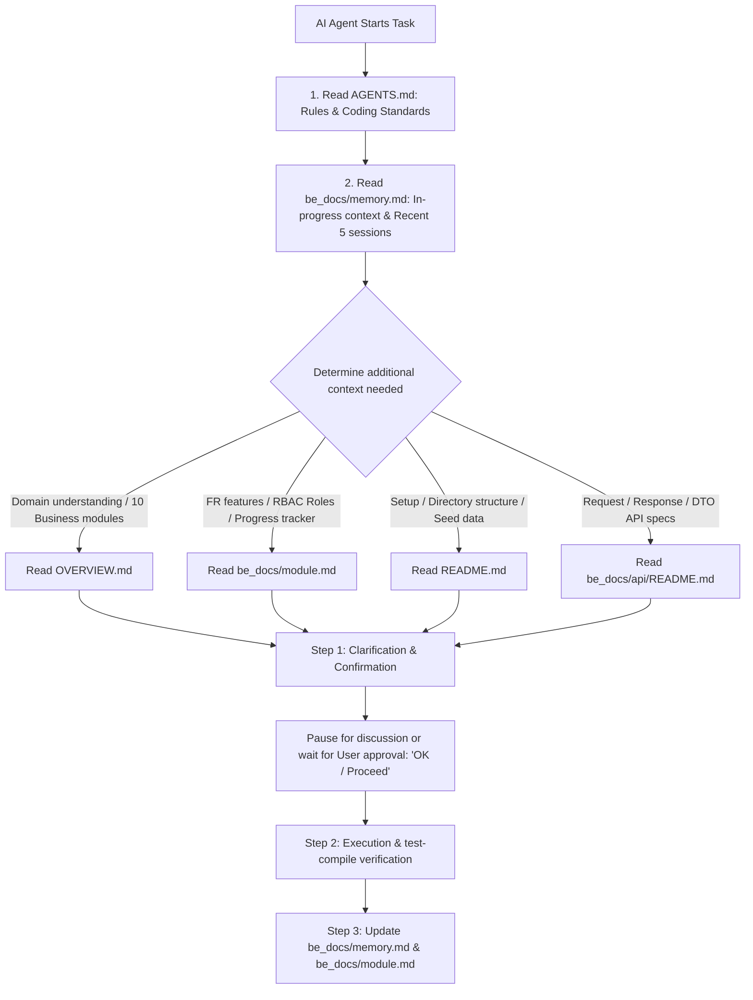

# AI AGENT GUIDELINES & CODING STANDARDS (FA SEARCH BACKEND)

This document serves as the **mandatory behavioral guide, workflow process, and technical standard** for AI Agents developing the `fasearch` backend.

---

## I. AGENT NAVIGATION MAP

Before executing any task, the Agent **MUST** navigate through the following documents to establish full context:



- **[memory.md](./be_docs/memory.md):** Working memory & handover log (Current Context, Gotchas & Recent 5 sessions). **Mandatory first read to maintain task continuity**.
- **[module.md](./be_docs/module.md):** 54 Functional Requirements (`FR-01` -> `FR-54`, `FR-NC1` -> `NC3`), RBAC role matrix, and progress tracker (`X` / `O`).
- **[be_docs/api/README.md](./be_docs/api/README.md):** Detailed technical specifications of Request/Response JSON, error codes, and parameters for all 10 API modules.
- **[OVERVIEW.md](./OVERVIEW.md):** Business context, Omnichannel solution, target personas (`ADMIN`, `STAFF`, `CUSTOMER`), and 10 core business modules.
- **[README.md](./README.md):** Setup guide, `.env` config, actual project structure, seed credentials, and active endpoints.

---

## II. MANDATORY WORKFLOW (3-STEP PROCESS)

For **EVERY incoming request or task**, AI Agents **MUST NEVER write code immediately**. Follow this strict 3-step workflow:

### Step 1: Clarification & Confirmation
1. **Read [be_docs/memory.md](./be_docs/memory.md):** Grasp in-progress tasks and technical gotchas from previous sessions.
2. **List affected files:** Explicitly state all files to be created, modified, or deleted.
3. **Clarify critical edge cases & constraints:**
   - **RBAC Authorization:** Who is permitted to access this API/feature (`ADMIN`, `STAFF`, `CUSTOMER`, or Public)?
   - **Data & Validation:** Required/optional fields, regex formats, length constraints, new Enum/Status values (MUST be UPPER_SNAKE_CASE English).
   - **Exception logic & Constraints:** Guard conditions, foreign key constraints, soft delete strategy, transactional rollback (`@Transactional`).
4. **Summarize execution plan:** Present order of implementation by architectural layer (`DTO -> Entity/Repo -> Service -> Mapper -> Controller`).
5. **PAUSE AND WAIT FOR USER CONFIRMATION:** Do not code until the user confirms with: *"OK / Proceed"* (or *"OK / Làm đi"*).

### Step 2: Execution
- Only start coding once the user provides clear approval: **"OK / Proceed"**.
- Mandatory compilation check: `./mvnw.cmd test-compile`.

### Step 3: Handover & Memory Sync
Upon code completion and successful compilation:
1. **Update feature progress:** Mark `X` on the corresponding FR in [be_docs/module.md](./be_docs/module.md).
2. **Update working memory [be_docs/memory.md](./be_docs/memory.md):**
   - Update `1. CURRENT CONTEXT` (active task, next steps, new gotchas).
   - Append 1 new session to `2. RECENT 5 SESSIONS`.
   - **Mandatory Pruning:** Keep at most 5 recent sessions (prune the oldest when a 6th is added).

---

## III. MODULE SCOPE & ROADMAP TRACKING

### 1. Module Boundaries & Admin Mechanism
- **Module `auth` (`com.springboot.fasearch.modules.auth`):**
  - Manages authentication, authorization, and token lifecycle.
  - Security components reside in dedicated package `com.springboot.fasearch.security` (`JwtProvider`, `JwtAuthenticationFilter`, `JwtAuthenticationEntryPoint`, `CustomAccessDeniedHandler`).
  - Manages database tables: `tai_khoan` and `vai_tro`.
- **Module `user` (`com.springboot.fasearch.modules.user`):**
  - Manages user profiles across the system.
  - Manages database tables: `khach_hang` and `nhan_vien`.
  - **Admin Rule:** **No separate admin table**. Administrators (`ADMIN`) are stored in `nhan_vien`, with their linked `tai_khoan` assigned the `ADMIN` role in `vai_tro`.

### 2. Project Roadmap Tracker
The complete progress of all 54 functional requirements across 10 business modules is tracked centrally in **[be_docs/module.md](./be_docs/module.md)** (`X`: Completed, `O`: In Progress, blank: Pending).

> 📌 **Rule for Agents:** Before starting a new task, Agents MUST inspect [module.md](./be_docs/module.md) to identify the next priority feature and update status upon completion.

---

## IV. CODING STANDARDS & ARCHITECTURAL GUIDELINES

### 1. Package Separation: Security vs Config
- **`com.springboot.fasearch.config`:** Global Spring Configuration Beans only (`SecurityConfig.java`, `JwtConfig.java`, `OpenApiConfig.java`...).
- **`com.springboot.fasearch.security`:** Security execution logic (`JwtProvider.java`, `JwtAuthenticationFilter.java`, `JwtAuthenticationEntryPoint.java`, `CustomAccessDeniedHandler.java`).

### 2. Type-Safe Enums & Constants
- **100% of Enums, Statuses, Types, and Roles MUST be written in UPPER_SNAKE_CASE English**.
- Never hardcode raw strings in Entities or Services; use pre-built Java Enums in `com.springboot.fasearch.common.enums`:
  - `AccountStatus`: `ACTIVE`, `INACTIVE`, `LOCKED`, `DELETED`
  - `RoleType`: `ADMIN`, `STAFF`, `CUSTOMER`
  - `Gender`: `MALE`, `FEMALE`, `OTHER`
  - `ProductStatus`: `DRAFT`, `ACTIVE`, `OUT_OF_STOCK`, `DISCONTINUED`
  - `OrderStatus`: `PENDING`, `CONFIRMED`, `PACKING`, `SHIPPING`, `COMPLETED`, `CANCELLED`, `RETURNED`
  - `PaymentMethodType`: `CASH`, `BANK_TRANSFER`, `VNPAY_QR`, `MOMO`
  - `PaymentStatus`: `PENDING`, `PAID`, `FAILED`, `REFUNDED`
  - `DiscountType`: `PERCENTAGE`, `FIXED_AMOUNT`
  - `VoucherStatus`: `UPCOMING`, `ACTIVE`, `EXPIRED`, `DISABLED`
  - `ReturnOrderType`: `RETURN`, `EXCHANGE`
  - `ReturnOrderStatus`: `PENDING`, `APPROVED`, `REJECTED`, `COMPLETED`

### 3. Soft Delete Strategy
- Core entities apply Soft Delete universally.
- Database tables use column `da_xoa BOOLEAN DEFAULT FALSE`.
- JPA Entities apply Hibernate 6 annotation: `@SQLRestriction("da_xoa = false")`.
- On deletion, update `isDeleted = true` (or `da_xoa = true`); never execute raw `DELETE FROM` statements unless clearing temporary join tables.

### 4. Pagination & Filtering Standards
- Use Spring Data JPA's standard `Pageable` and `Page<T>`.
- Standard query parameters:
  - `page`: Page index (0-indexed according to Spring Boot standards).
  - `size`: Items per page (default: 10 or 20).
  - `sort`: Sorting criteria (e.g., `createdAt,desc`).
- Standard paginated `ApiResponse<T>` structure:
  ```json
  {
    "success": true,
    "code": 200,
    "message": "Retrieved list successfully",
    "result": {
      "content": [ ... ],
      "pageNumber": 0,
      "pageSize": 10,
      "totalElements": 45,
      "totalPages": 5,
      "isLast": false
    },
    "errors": null,
    "timestamp": "2026-10-25T13:00:00"
  }
  ```

### 5. Centralized Exception Handling
- Managed via `@RestControllerAdvice` in `GlobalExceptionHandler`.
- **Mandatory HTTP Status Mapping:** HTTP Status Code in the Header **MUST accurately reflect** the `ErrorCode` semantics:
  - `CUSTOMER_NOT_FOUND`, `RESOURCE_NOT_FOUND` -> HTTP **404 Not Found**.
  - Validation failures, constraint violations -> HTTP **400 Bad Request**.
  - Unauthenticated (Invalid / Expired Token) -> HTTP **401 Unauthorized**.
  - Access Denied (Insufficient role privileges) -> HTTP **403 Forbidden**.
  - Unsupported HTTP method (`HttpRequestMethodNotSupportedException`) -> HTTP **405 Method Not Allowed**.
  - Unhandled / System runtime exceptions (`RuntimeException`) -> HTTP **500 Internal Server Error**.

### 6. Standard API Response Structure (`ApiResponse<T>`)
- All controller endpoints must wrap results in `ApiResponse<T>`:
  ```json
  {
    "success": true,
    "code": 200,
    "message": "Operation description",
    "result": { ... },
    "errors": null,
    "timestamp": "2026-10-25T13:00:00"
  }
  ```

### 7. Naming Conventions
- **Entity:** PascalCase, singular English noun (e.g., `Customer.java`, `Employee.java`, `Account.java`, `Role.java`).
- **Request DTO:** PascalCase + `Req` suffix (e.g., `CustomerCreateReq.java`, `LoginReq.java`).
- **Response DTO:** PascalCase + `Res` suffix (e.g., `CustomerRes.java`, `AuthRes.java`).
- **Mapper:** PascalCase + `Mapper` suffix (e.g., `CustomerMapper.java`).
- **Service Interface:** PascalCase + `Service` suffix (e.g., `CustomerService.java`, `AuthService.java`).
- **Service Implementation:** PascalCase + `ServiceImpl` suffix (e.g., `CustomerServiceImpl.java`, `AuthServiceImpl.java`).
- **Controller:** PascalCase + `Controller` suffix (e.g., `CustomerController.java`, `AuthController.java`).
- **Endpoint URL:** `kebab-case`, plural nouns, versioned: `/api/v1/customers`, `/api/v1/auth/login`.

---

## V. AGENT CLI VERIFICATION CHEATSHEET

> 💡 **Full CLI Reference:** See **[README.md — CLI Cheatsheet](./README.md#vi-bang-lenh-cli-chuan-cli-cheatsheet)**.

After completing any code changes in **Step 2 (Execution)**, AI Agents **MUST** execute compile verification before reporting back:

```powershell
# 1. Compile check & MapStruct code generation (Mandatory after every code task)
./mvnw.cmd test-compile

# 2. Run automated tests (When business logic or test cases are updated)
./mvnw.cmd clean test

# 3. Clean target directory
./mvnw.cmd clean

# 4. Run Spring Boot application (Smoke test to ensure app starts without crashing)
./mvnw.cmd spring-boot:run
```
