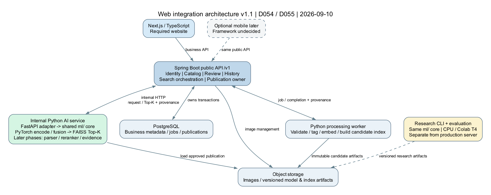
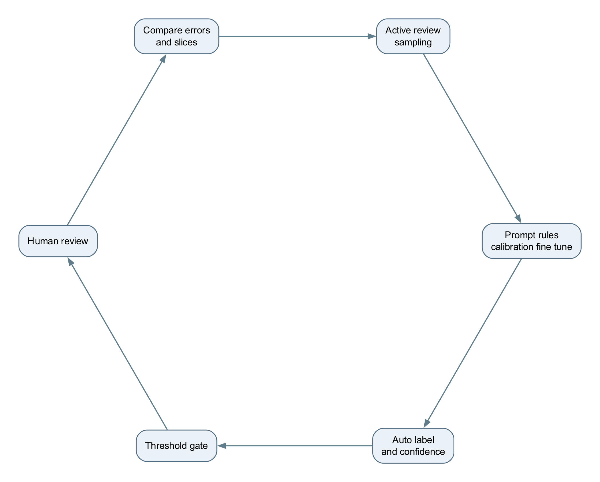
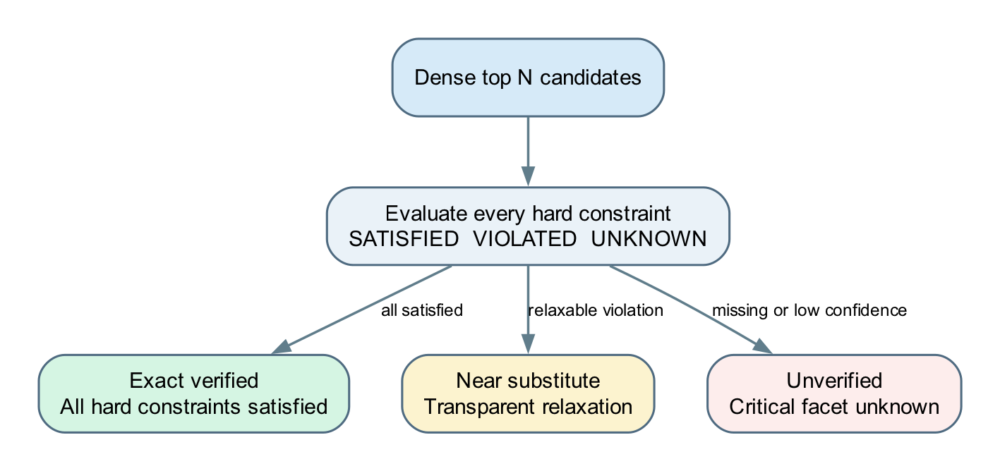
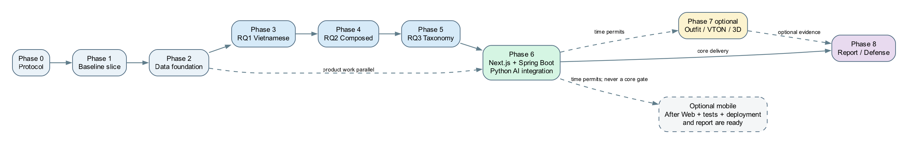

# Tóm tắt điều hành

Đồ án xây dựng một hệ thống tìm kiếm sản phẩm thời trang cho phép người dùng truy vấn bằng ảnh, tiếng Việt tự nhiên hoặc kết hợp một ảnh tham chiếu với yêu cầu sửa đổi. Điểm trọng tâm không phải cạnh tranh bằng quy mô catalog với Google hoặc TikTok. Giá trị của hệ thống nằm ở khả năng hiểu ngôn ngữ thời trang tiếng Việt, phân biệt thuộc tính mịn, xử lý truy vấn composed image-text, kiểm soát ràng buộc bằng taxonomy và cung cấp bằng chứng giải thích được.

Đồ án thuộc nhóm **tích hợp**, nhưng phần nghiên cứu phải đủ sâu để chứng minh các lựa chọn AI bằng thí nghiệm có đối chứng. Ba câu hỏi nghiên cứu đã được khóa:

1. Thích nghi miền thời trang và tiếng Việt giúp text-to-image retrieval tốt hơn các frozen baseline đến mức nào.
2. Chiến lược fusion và fine-grained hard negatives giúp composed image-text retrieval tốt hơn đến mức nào.
3. Taxonomy-aware parsing, filtering và reranking cải thiện constraint satisfaction ra sao, chịu suy giảm thế nào khi dùng parser và product facets production, đồng thời đánh đổi bao nhiêu về coverage, explainability và latency.

MVP catalog chỉ gồm **TOP, BOTTOM và ONE_PIECE**. Seller đăng sản phẩm, hệ thống gắn nhãn và sinh embedding, human reviewer duyệt các trường hợp không chắc chắn, sau đó sản phẩm mới đi vào catalog tìm kiếm. Website dùng Next.js/TypeScript; backend nghiệp vụ và API công khai dùng Java Spring Boot. Dịch vụ AI Python dùng FastAPI nội bộ làm adapter cho PyTorch, FAISS và core `ai/ml/` đã chạy ở Week 4. Mobile là mở rộng tùy thời gian sau khi website/search core, kiểm thử, triển khai và báo cáo đã sẵn sàng; framework mobile chưa chọn (D054/D055).

Outfit compatibility, virtual try-on và avatar 3D là các lớp mở rộng. Outfit MVP dùng general compatibility có named factors và GA2M để giải thích. Virtual try-on và 3D phải có benchmark riêng, không được trộn với retrieval benchmark hoặc được dùng để claim cải thiện ba RQ chính.

# Căn chỉnh với brief chính thức

| Yêu cầu trong brief | Cách đồ án đáp ứng |
|---|---|
| Nghiên cứu kết hợp embedding ảnh và văn bản | RQ1 đánh domain và Vietnamese adaptation; RQ2 đánh equal, fixed và adaptive fusion |
| Ứng dụng CLIP hoặc tương tự | Frozen multilingual CLIP, ViCLIP-OT và model fashion/Vietnamese adapted |
| Website tìm bằng text, image và kết hợp ảnh–văn bản | Next.js gọi Search API Spring Boot, backend tích hợp dịch vụ AI Python |
| Biểu diễn sản phẩm trong không gian vector | L2-normalized image/text embeddings, FAISS index, cosine similarity |
| Tìm bằng cosine hoặc Euclidean | Cosine là metric chính; trên vector chuẩn hóa, thứ hạng Euclidean bình phương tương đương |
| Giao diện tìm kiếm sản phẩm | Search, result lanes, filter, explanation, history và seller dashboard |
| Recall at K và Precision at K | Triển khai hai metric bắt buộc; bổ sung nDCG, strict/relaxed MRR, TargetRecall, ConstraintSatisfied, confidence interval và slice analysis |
| Đánh giá thời gian và phản hồi người dùng | Component/end-to-end p50 p95, latency-depth curve và optional usability study |
| Dataset công khai hoặc tự thu thập | Public fashion datasets cho training; catalog Việt và benchmark native-human cho localization/evaluation |
| Mục 7: Java Spring Boot và Next.js; ngôn ngữ Java/Python, thư viện AI và cơ sở dữ liệu phù hợp | Next.js frontend, Spring Boot backend, Python/PyTorch/FAISS cho AI và PostgreSQL cho metadata; FastAPI là lựa chọn adapter nội bộ của nhóm |

Đề cương chính thức mục 5–7 và rubric mục 9 yêu cầu website và Backend API, không liệt kê mobile là deliverable bắt buộc. D005 cũ đã được thay bằng D054/D055 ngày 10/09/2026; xem change record trong [Decision Register](10_DECISION_REGISTER.md). Việc đổi stack không thay các research protocol hoặc kết quả pilot đã khóa.

# Vấn đề nghiên cứu và điểm mới

## Vấn đề

Tìm kiếm từ khóa truyền thống khó biểu diễn trọn vẹn màu sắc, chất liệu, họa tiết, phom dáng, mức trang trọng, dịp sử dụng và vibe. Model vision-language tổng quát có thể hiểu khái niệm rộng nhưng thường yếu ở:

- từ vựng và lối gõ tiếng Việt đời thường;
- thuộc tính thời trang gần nhau như be và kem;
- phủ định và phạm vi phủ định;
- yêu cầu tương đối so với ảnh tham chiếu như dài hơn, ít formal hơn;
- nhiều ràng buộc cùng lúc;
- giải thích vì sao một kết quả được chọn;
- đảm bảo kết quả không vi phạm constraint cứng.

## Đóng góp dự kiến

1. Một taxonomy thời trang MVP có lớp vật lý, lớp category-specific và lớp semantic.
2. Một benchmark truy hồi tiếng Việt native-human có intent card, graded qrels, reason codes, inter-rater agreement và chống leakage.
3. Một curriculum adaptation theo miền thời trang, tiếng Việt, composed retrieval và hard negatives.
4. Một ablation rõ ràng cho modality, fusion và training regime.
5. Một pipeline taxonomy-aware tách oracle input, parser degradation, facet-tagger degradation và interaction.
6. Một cơ chế result lanes Exact, Substitute và Unverified có relaxation deterministic.
7. Một evidence protocol có completeness, deterministic consistency và human-rated verbalization faithfulness.
8. Một website tích hợp chứng minh catalog ingestion, vector indexing, search và human-in-the-loop hoạt động end to end.

Điểm mới cần được phát biểu trong phạm vi đồ án: **kết hợp Vietnamese multimodal retrieval, fine-grained taxonomy, composed modification, graded evaluation và evidence có thể truy vết trong một hệ thống thời trang MVP**. Không tuyên bố đã vượt Google/TikTok hoặc phát minh CLIP, VTON hay SMPL-X.

# Phạm vi sản phẩm

## Core bắt buộc

- Tìm bằng văn bản tiếng Việt.
- Tìm bằng ảnh.
- Tìm bằng ảnh tham chiếu cộng mô tả sửa đổi.
- Hiểu thuộc tính mịn và vibe theo taxonomy.
- Trả explanation dựa trên structured evidence.
- Seller CRUD sản phẩm và ảnh.
- AI tag, confidence, review queue và publish catalog.
- Tạo, cập nhật và version embedding/index.
- Website Next.js tích hợp đầy đủ backend Spring Boot và dịch vụ AI Python.
- Research dashboard hoặc script để xem metric, lỗi và provenance.

## Điểm cộng sau core

- Mobile dùng cùng API Spring Boot nếu còn thời gian sau website/search, kiểm thử, triển khai và báo cáo; framework và nền tảng đích chỉ chọn khi mở phần này.
- General outfit compatibility cho top cộng bottom.
- Context hoặc vibe rerank nhẹ.
- Counterfactual bằng sản phẩm có thật trong catalog.
- Guided photo capture và VTON prototype.
- Avatar parametric hoặc 3D prototype.

## Ngoài phạm vi

- Full marketplace aggregator hoặc đối đầu bằng catalog massive.
- POS, kế toán, tồn kho nhiều chi nhánh, thanh toán, giao vận, đổi trả và loyalty.
- Production SLA 99.9 percent hoặc hàng trăm nghìn concurrent users.
- Perfect body measurement từ một ảnh.
- Mô phỏng vật lý chính xác của mọi chất liệu và layering.
- Medical, health hoặc body-shape judgment.

# Người dùng và luồng giá trị

## Shopper

1. Chọn chế độ text, image hoặc composed.
2. Nhập tiếng Việt tự nhiên, kể cả colloquial, code-switch hoặc phủ định.
3. Xem kết quả Exact trước, Substitute và Unverified khi cần.
4. Xem bằng chứng matched/violated, confidence và lý do xếp hạng.
5. Lưu sản phẩm hoặc outfit để so sánh.
6. Tùy chọn thử outfit/VTON khi feature đã được bật.

## Seller

1. Tạo sản phẩm ở trạng thái Draft.
2. Tải ảnh và metadata tối thiểu.
3. Job bất đồng bộ chạy quality check, dedupe, tagger và embedding.
4. Sản phẩm confidence thấp vào NeedsReview.
5. Seller hoặc reviewer sửa taxonomy facets.
6. Embedding được tạo lại nếu trường ảnh/text ảnh hưởng representation thay đổi.
7. Product version được publish atomically vào catalog/index.

## Admin hoặc researcher

- Quản lý taxonomy version.
- Duyệt active review queue.
- Theo dõi tagger error theo attribute/class.
- Tạo catalog snapshot và split manifest.
- Chạy benchmark, khóa experiment manifest và xem lỗi theo reason code.
- Rollback model/index version khi guardrail regression.

# Kiến trúc tổng thể

```text
Next.js Website (mobile optional later)
                 |
                 v
Spring Boot API /v1
  Identity | Catalog | Review | History | Search orchestration
       |                  |                     |
  PostgreSQL         Object Storage       Internal HTTP
                                                |
                                  Python AI service (FastAPI)
                                    core ml/ + PyTorch/FAISS
                                    Encode -> Retrieve -> Top-K
                                    Later: parser/reranker/evidence

Spring Boot jobs -> Python processing worker -> versioned model/index artifacts
                  <- completion/provenance <-
```

{width=90%}

Sơ đồ mô tả kiến trúc sản phẩm dự kiến; Week 4 đã chạy core Python/CLI, các Web/HTTP adapter được triển khai ở phase tích hợp. [Nguồn sơ đồ v1.1](../tools/assets/system_architecture.web-v1.1.dot) giữ riêng với ảnh kiến trúc Flutter v1 lịch sử.

## Các service logic

| Service | Trách nhiệm | Không được làm |
|---|---|---|
| Identity/Catalog/Review/History (Spring Boot modules) | Auth, quyền, product lifecycle/version, image, facets và dữ liệu nghiệp vụ | Không tự publish khi job chưa hoàn tất; không chạy encoder trong JVM |
| Search orchestration (Spring Boot) | Validate quyền/input, resolve publication, gọi AI qua HTTP, trả metadata/versions và log request | Không tự tính lại fusion hoặc đổi thứ hạng do AI trả |
| AI adapter (FastAPI nội bộ) | Gọi core Python dùng chung CLI, kiểm tra model/index/catalog version | Không sở hữu user/session/CRUD; không public trực tiếp cho browser |
| Tagger | Dự đoán structured facets và confidence | Không coi vibe là hard truth |
| Parser | Map query tự do thành intent card | Không tự thay đổi taxonomy |
| Retriever | Encode query, tìm candidate trong vector space | Không dùng final test để tune |
| Reranker | Áp constraint, score taxonomy và relaxation | Không âm thầm vi phạm must_not |
| Evidence | Tạo JSON truy vết và verbalization | Không thêm factual claim ngoài evidence |
| Compatibility | Chấm top-bottom bằng named factors và GA2M | Không trộn score vào retrieval benchmark |
| VTON 3D | Visualization tùy chọn | Không claim fit hoặc body accuracy nếu chưa đo |

## Vector representation

Ảnh sản phẩm và văn bản được mã hóa thành vector cùng chiều. Mọi vector dùng cho cosine retrieval được L2-normalize:

$$\hat{z}=\frac{z}{\lVert z\rVert_2}$$

Cosine similarity:

$$s(q,p)=\hat{z}_q^T\hat{z}_p$$

Trên unit sphere, squared Euclidean distance bằng $2-2s(q,p)$ nên hai cách cho cùng thứ hạng nếu preprocessing giống nhau. Cosine được chọn để định nghĩa metric rõ ràng và tương thích với CLIP-style representation.

# Dữ liệu và taxonomy

## Vì sao dùng nhiều nguồn dữ liệu

Ba loại dữ liệu giải quyết ba khoảng trống khác nhau, không phải trộn ba dataset để làm số lượng lớn:

| Nhóm | Vai trò | Ví dụ candidate |
|---|---|---|
| Fashion domain và catalog seed | Học ảnh, category, attribute và product language; dựng baseline end-to-end | Fashion Product Images Dataset từ Myntra/Kaggle là Dataset A; DeepFashion2 hoặc FashionGen chỉ bổ sung khi có khoảng trống rõ |
| Composed retrieval | Học quan hệ anchor, modification, target | FashionIQ; CIRR dùng như auxiliary robustness, không thay fashion benchmark |
| Vietnamese localization | Học tiếng Việt và đánh giá thực tế | Catalog Việt tự xây, caption/intent Silver và Gold native-human |

Dataset được chọn sau data audit về khả năng tải, license, chất lượng ảnh, taxonomy mapping, duplicate và overlap. Không merge split mặc định của dataset công khai với custom final test.

Dataset A trên Kaggle có khoảng 44 nghìn ảnh sản phẩm và metadata category/article type/color/season/usage, nên phù hợp để khởi động catalog, baseline và weak-label pipeline. Nó không có Vietnamese Gold queries, composed triplets, material/pattern/vibe Gold labels, outfit pairs hoặc VTON pairs. Vì vậy Dataset A thay được phần catalog/fashion-domain seed, nhưng không thay FashionIQ hoặc custom RQ2 data, benchmark tiếng Việt và các dataset bonus chuyên biệt.

## Các tầng dữ liệu

| Tầng | Nguồn | Mục đích | Cấm dùng |
|---|---|---|---|
| Bronze | Machine translation, LLM captions, weak labels | Pretraining và candidate generation | Final validation/test claim |
| Silver | Human-corrected hoặc selective-reviewed | Training và validation | Thay thế hoàn toàn Gold final test |
| Gold | Native-human query, intent frozen, judged facets/qrels | Final evaluation | Prompt/model tuning |

## Taxonomy ba lớp

### Global physical and metadata

- category;
- color;
- material;
- pattern;
- audience.

### Category-specific

- TOP: subtype, neckline, collar, sleeve, fit, length, closure.
- BOTTOM: subtype, rise, leg shape, fit, length, closure.
- ONE_PIECE: subtype, neckline, sleeve, waistline, silhouette, length.

### Semantic

- style hoặc vibe;
- occasion;
- season;
- formality.

Semantic facets là multi-label, probabilistic và thường dùng rerank. Chúng không được dùng như hard filter trừ khi query ghi rõ và protocol cho phép.

## Confidence và human-in-the-loop

Threshold phải được tune theo attribute và class. Ví dụ màu be/kem có thể được canonicalize thành `be-kem` với confidence thấp thay vì ép nhãn. Quy trình trưởng thành:

1. Từ 0 đến khoảng 200 reviewed labels: sửa prompt, taxonomy alias và deterministic rule.
2. Từ khoảng 200 đến 1000 labels: calibration, threshold và active review theo lỗi thực tế.
3. Khi có đủ nhãn chất lượng cho từng nhóm thuộc tính: linear probe, adapter hoặc LoRA local.

Active review sampling kết hợp uncertainty, diversity và random audit. Không chỉ chọn confidence thấp vì sẽ bỏ sót lỗi tự tin sai.

```text
Auto label -> Confidence gate -> Human review -> Compare with model
     ^                                               |
     |                                               v
Prompt and rules <- Threshold/calibration <- Active review sampling
     |                                               |
     +---------------- Data flywheel ----------------+
```

{width=70%}

## Dedupe và split

- Cluster bằng perceptual hash cộng title similarity trước split.
- Mọi biến thể và cross-seller near-duplicate trong cùng product group.
- Cả cluster chỉ thuộc một trong train, validation hoặc test.
- Anchor và target của một composed pair phải nằm cùng split.
- Cấm train anchor đi cùng test target và ngược lại.
- Template family được hold out cho test.
- Test author không xem product title, product ID, training triplet hoặc generated training query.

# Training curriculum

## Stage 0 Frozen baseline

Chạy exact pretrained checkpoints, lưu preprocessing, index và metric. Không train. Baseline tối thiểu gồm một multilingual CLIP-style model và ViCLIP-OT frozen.

## Stage 1 Fashion domain alignment

Học fashion image-text alignment trên dữ liệu domain. Stage chỉ tồn tại nếu có nguồn English fashion caption sạch đủ tách khỏi Vietnamese adaptation. Nếu không, bỏ Stage 1 khỏi causal ladder và chạy 2-way frozen đến Vietnamese-adapted.

## Stage 2 Vietnamese alignment

Align Vietnamese text encoder với fashion image representation bằng Bronze/Silver Vietnamese pairs. Có thể freeze image tower ban đầu, train projector/text-side rồi unfreeze có kiểm soát. Giữ English/fashion replay để hạn chế quên miền.

## Stage 3 Composed retrieval

Học biểu diễn query từ anchor image và modification text để gần target. Dữ liệu gồm FashionIQ-style triplet, custom Vietnamese triplets và positive alternatives khi có qrels.

## Stage 4 Fine-grained hard negatives

Giữ kiến trúc và thêm negatives cùng category, gần embedding nhưng vi phạm đúng một major constraint. Curated miner dùng frozen Stage 2 checkpoint. Mỗi negative ghi provenance và version.

## Stage 5 Joint consolidation

Khởi tạo từ Stage 4, joint fine-tune ngắn với balanced replay và retention distillation. Đây là package challenger, không claim thành phần riêng gây gain. Chỉ promote nếu thắng validation primary metric và không regression guardrails; nếu không giữ Stage 4.

## Quy tắc epoch và compute

Không đặt chất lượng bằng số epoch hoặc train loss. Epoch phụ thuộc kích thước dataset và sampling. Protocol ghi:

- examples seen và optimizer steps;
- effective batch size;
- learning-rate schedule;
- precision FP16 hoặc BF16 nếu hỗ trợ;
- validation interval và early-stopping patience;
- best checkpoint theo primary metric;
- tối thiểu ba seed cho final shortlisted configurations nếu compute cho phép;
- GPU-hours và peak memory.

T4 là lựa chọn mặc định vì PyTorch/FAISS workflow trực tiếp. TPU v5e chỉ dùng khi pipeline XLA đã chạy đúng và lợi ích compute bù được chi phí chuyển đổi.

# Research Question 1

## Câu hỏi

Việc thích nghi miền thời trang và tiếng Việt cải thiện chất lượng truy hồi sản phẩm từ truy vấn tiếng Việt đến mức nào so với các mô hình frozen đa ngôn ngữ và pretrained chuyên tiếng Việt, xét tổng thể và theo các lát cắt ngôn ngữ?

## Phạm vi cô lập

RQ1 chỉ đánh Vietnamese text-to-image retrieval. Không parser, taxonomy filter, reranker hoặc composed image-text fusion.

## Hệ thống so sánh

| ID | Hệ thống | Điều kiện |
|---|---|---|
| B0 | Frozen multilingual model | Exact checkpoint chốt trước run |
| B1 | Frozen ViCLIP-OT | Exact checkpoint và preprocessing chính thức |
| M1 | Fashion-adapted | Chỉ có nếu Stage 1 data audit pass |
| M2 | Fashion plus Vietnamese-adapted | Model đề xuất |
| C1 | English continuation control | Optional; cùng số step/data budget để cô lập language effect |

## Query metadata đa trục

```yaml
origin: native_human
generation_mode: taxonomy_controlled | freeform_natural
register: standard | colloquial
orthography:
  - clean
  - missing_diacritics
  - abbreviation
  - teencode
  - typo
language_mix: none | lexicalized_fashion_loanword | true_code_switch
negation_type: none | lexicalized_attribute | compositional_negation
```

Các slice chồng lấn. Query có thể vừa colloquial, vừa missing diacritics, vừa true negation. Metadata do author gắn và reviewer khác xác nhận.

## Metric

- Primary: nDCG at 10 với grade 0 đến 3.
- Secondary: MRR at 10 strict, relevant khi grade lớn hơn hoặc bằng 2.
- Secondary: MRR at 10 relaxed, relevant khi grade lớn hơn hoặc bằng 1.
- Supporting: Recall at 10 và Recall at 50.
- Paired bootstrap 95 percent confidence interval trên query-level delta.
- Slice dưới 20 query chỉ mô tả; 20 đến 39 exploratory; từ khoảng 40 mới dùng cho kết luận slice có điều kiện.

Final Gold test mục tiêu 200 đến 300 query, tối thiểu 200. Pilot query không được nhập lại final test.

# Research Question 2

## Câu hỏi

Các chiến lược fusion và huấn luyện với fine-grained hard negatives cải thiện composed image-text fashion retrieval đến mức nào so với các baseline đơn phương thức, equal-weight và fixed-weight, xét tổng thể và theo loại modification?

## Query composition

Mỗi query có:

```yaml
primary_edit_attribute: color
all_edit_attributes: [color, material]
query_complexity: single_attribute | multi_attribute
```

Bộ 400 query gồm 240 controlled và 160 natural. Với sáu primary edit families, 240 controlled cho đúng 40 query mỗi family. TargetRecall chạy tự động trên cả 400. Pooled judged subset khoảng 100 gồm 60 controlled, tương đương 10 mỗi family, và 40 natural. Do đó per-attribute graded result chỉ confirmatory khi support thực tế đủ; không ghi nhầm 40 mỗi attribute cho pool 100.

## Panel A Modality and fusion

| Row | Query representation | Ý nghĩa |
|---|---|---|
| A0 | Image-only anchor | Đo anchor sufficiency và giá trị text modification |
| A1 | Text-only modification | Đo text shortcut và leakage risk, không diễn giải đối xứng với A0 |
| A2 | Equal-weight alpha 0.5 | Baseline ghép chuẩn hóa |
| A3 | Một fixed alpha | Fit bằng grid search trên train; validation chỉ chọn/freeze |
| A4 | Adaptive scalar alpha | Alpha phụ thuộc input qua combiner nhỏ |

Với normalized embeddings:

$$q=\operatorname{L2Norm}(\alpha e_i+(1-\alpha)e_t)$$

Encoder checkpoint và candidate catalog được giữ nguyên trong Panel A. A4 chỉ train gate nhỏ, không được âm thầm sinh một vector latent hoàn toàn mới.

## Panel B Training intervention

| Row | Regime | Diễn giải được phép |
|---|---|---|
| B0 | A4 plus random hoặc in-batch negatives | Control |
| B1 | A4 plus curated hard negatives | Hiệu ứng của negative sampling khi compute giữ tương đương |
| B2 | Stage 5 consolidation package | So package; không claim causal cho từng sub-change |

## Hard-negative purity

Curated negative phải:

- cùng category;
- gần target trong frozen Stage 2 embedding;
- vi phạm đúng một major constraint;
- không phải designated target, product group duplicate, grade lớn hơn hoặc bằng 1, hoặc alternate item thỏa toàn bộ hard constraints.

Tier 1 ghi `gold_facet_based` hoặc `silver_fallback`. Tier 2 random/in-batch chấp nhận nhiễu nhưng phải ước lượng contamination. Sau pooling, đối chiếu list với qrels; contamination trên 5 percent buộc loại, tạo negatives v2 và retrain.

## Health gates

- L1 dataset health: text-only TargetRecall vượt threshold đã chốt trên validation, vùng điều tra ban đầu 0.35 đến 0.40, phải audit title leakage và self-contained target description.
- L2 combiner health: log mean, variance và distribution alpha theo primary attribute; flag near-constant hoặc collapse về một modality.

# Research Question 3

## Câu hỏi

Taxonomy-aware parsing, filtering và reranking cải thiện mức độ thỏa ràng buộc và graded relevance đến đâu so với dense retrieval; mức cải thiện còn lại bao nhiêu khi thay gold intent và gold product facets bằng đầu ra production, và phải đánh đổi thế nào về result coverage, explanation faithfulness và latency?

## Matrix và ceiling

```text
D     Dense baseline
T_GG  Gold intent      plus Gold facets
T_PG  Predicted intent plus Gold facets
T_GP  Gold intent      plus Production facets
T_PP  Predicted intent plus Production facets
```

Các đại lượng:

```text
Taxonomy headroom = T_GG - D
Parser loss       = T_GG - T_PG
Facet tagger loss = T_GG - T_GP
Deployment gain  = T_PP - D
Interaction      = T_PP - T_PG - T_GP + T_GG
```

`T_GG` được gọi là oracle-input trong frozen judged candidate pool, không phải global ceiling. Báo thêm `Ideal@N`, tức qrels-optimal ranking trong candidate set, và `CandidateRecall@N`.

Mọi bảng matrix đóng dấu catalog snapshot, tagger checkpoint, parser version và response freeze date. Re-run bằng version mới tạo bảng mới, không ghi đè.

## Structured intent

Năm logical groups:

- must_change;
- must_preserve;
- must_not;
- soft_preference;
- dont_care.

Mỗi constraint chứa:

```yaml
attribute: length
operator: LONGER_THAN
value: null
reference: anchor
priority: primary
source: explicit
confidence: 0.93
```

## Result lanes và relaxation

Product constraint state là SATISFIED, VIOLATED hoặc UNKNOWN.

{width=75%}

- Exact verified: mọi hard constraint SATISFIED.
- Near substitute: vi phạm constraint được phép relax và được công khai.
- Unverified: thiếu hoặc confidence facet thấp nên chưa thể xác nhận.

Category và explicit must_not không bao giờ relax. Trong cùng priority, inferred được relax trước explicit. Soft preference chỉ rerank. Confidence dưới calibrated threshold thành UNKNOWN; log parser abstention, product facet low confidence, missing information hoặc multiple.

`inventory_answerable` được tính bằng code từ gold facets. Unanswerable queries được giữ thành slice riêng để chấm hệ thống có báo không có exact match và đưa fallback đúng cách hay không.

## Coverage metrics

$$\operatorname{Shortfall@L}=\operatorname{mean}_q\frac{\max(0,L-|E_q|)}{L}$$

Trong đó $E_q$ là tập exact verified results. Báo ZeroResultRate exact, Shortfall, RelaxationRate, UnverifiedRate và DisplayedConstraintViolation at K.

## Evidence

1. EvidenceCompleteness at K kiểm tra đủ schema fields.
2. EvidenceConsistency tái tính phần deterministic trong epsilon. Đây là CI assertion; mismatch làm run invalid.
3. VerbalizationFaithfulness chấm từng factual claim là Entailed, Unsupported hoặc Contradicted. Explanation fail nếu có ít nhất một Contradicted claim; báo thêm tỷ lệ entailed.

Structured evidence chỉ giải thích phần taxonomy/deterministic contribution. Dense similarity được công khai là latent similarity, không bịa semantic rationale.

## Latency

Với rerank depth N bằng 50, 100 và 200, báo CandidateRecall, nDCG, ConstraintSatisfied, Shortfall, component p50/p95 và end-to-end p50/p95. Hardware, catalog size, batch size, concurrency, cache state và warm-up phải cố định. Chọn N trên validation và freeze trước test.

## Parser diagnostics

Báo intent exact match, constraint set micro/macro F1, field F1, attribute, canonical value, operator, reference, negation detection và negation scope. Vì confidence điều khiển UNKNOWN, báo calibration và accuracy-coverage curve.

Correlation giữa per-query parser score và downstream loss chỉ là association. Gold-repair thay một field sai bằng gold rồi rerun để đo tác động trực tiếp. Gold-corruption thay một field đúng bằng lỗi có kiểm soát để đo độ nhạy của retriever/reranker.

# Benchmark và annotation

## Relevance grades

| Grade | Nhãn | Định nghĩa |
|---:|---|---|
| 3 | Highly Relevant | Khớp intent gần như hoàn toàn, gồm thuộc tính chính và ngữ cảnh |
| 2 | Relevant | Đúng phần lớn, sai một thuộc tính phụ hoặc có khác biệt vẫn chấp nhận mua |
| 1 | Acceptable Substitute | Sai thuộc tính chính nhưng còn cùng category hoặc vibe đủ để cân nhắc |
| 0 | Irrelevant | Sai category, intent hoặc không còn giá trị thay thế |

Ví dụ query `váy linen hoa nhí đi biển`:

- Grade 3: váy linen hoa nhí, phom phù hợp đi biển.
- Grade 2: váy hoa nhí cotton, các yếu tố còn lại phù hợp.
- Grade 1: váy trơn màu be nhưng cùng vintage/beach vibe.
- Grade 0: quần jeans hoặc sản phẩm sai hẳn nhu cầu.

## Reason codes

1. WRONG_CATEGORY.
2. NEGATION_VIOLATION.
3. MAJOR_ATTRIBUTE_MISMATCH.
4. MULTIPLE_MINOR_MISMATCHES.
5. VIBE_ONLY_MATCH.
6. OCCASION_MISMATCH.
7. INSUFFICIENT_PRODUCT_INFORMATION.

Reason 7 là CANNOT_JUDGE status và không tự động map grade 0. Duplicate được xử trước judging.

## Annotation protocol khóa

1. Query do người Việt viết tay, có thể có không dấu, teencode và code-switch.
2. Author không thuộc bất kỳ assessor nào của query đó.
3. Query và intent card freeze trước pooling.
4. Guideline versioned và freeze theo vòng chấm.
5. Raw grade, reason, timestamp, assessor và version được giữ bất biến.
6. Kappa tính trên raw trước adjudication, không tính lại để nâng điểm.
7. Adjudicator độc lập, blind, chỉ dùng intent clarification đã freeze.
8. Writing-style metadata chỉ dùng slice analysis.
9. Dispute patterns sau final qrels chỉ cập nhật guideline vòng sau.

Primary agreement là quadratic weighted Cohen kappa; báo thêm linear kappa, exact agreement, within-one agreement và confusion matrix. Kappa lớn hơn 0.60 là mục tiêu pass thực dụng; dưới 0.50 buộc review guideline, nhưng không che giấu con số raw.

## Pooling và miss audit

Candidate pool là union top results của nhiều retrieval runs, gồm frozen baselines, adapted model, fusion variants và taxonomy variant. Dùng known-target rank trên toàn query set và outside-pool audit để phát hiện hệ thống pooling bỏ sót item tốt. Unjudged item không tự động gán irrelevant trong qrels chính.

# Outfit compatibility

## Hai tầng

```text
General compatibility score
        plus
Context or vibe affinity with small alpha
```

Personalized behavior profile từ lịch sử user là future work. MVP không cần đủ dữ liệu hành vi cá nhân.

## Named factors và GA2M

Các factor candidate:

- color harmony;
- pattern balance;
- formality gap;
- silhouette match;
- material-season suitability;
- occasion alignment.

Default EXPLAINABLE mode chỉ dùng GA2M. Latent MLP branch chạy shadow. HYBRID chỉ bật khi thắng AUC/FITB đủ rõ và evidence ghi mode cùng latent weight.

Contributions được lưu trong logit space để cộng chính xác. Counterfactual thay một facet, lọc catalog thật và rerank bằng cùng scorer; nếu không có active product phù hợp thì không hiển thị hàng tưởng tượng.

## Data và evaluation

Positive từ curated outfit/lookbook mạnh hơn co-purchase. Co-purchase chỉ là weak positive. Negatives gồm shuffle, same-slot conflict, taxonomy conflict, hard và counterfactual. Không cần human label toàn bộ training data nhưng cần small human gold set để đánh AUC, FITB và explanation faithfulness.

# Virtual try-on và 3D

## Vai trò

VTON/3D giúp user hình dung outfit, không chứng minh chính xác kích cỡ hoặc độ vừa nếu chưa có measurement model. Feature tách khỏi retrieval benchmark và được trình bày là prototype/future research nếu không đủ thời gian.

## Input capture

- Không yêu cầu ảnh nude.
- Hướng dẫn user mặc trang phục gọn, đủ che phủ và dễ nhìn silhouette.
- UI dùng khung pose kiểu guided identity capture.
- Có front view, optional side view và manual measurement correction.
- Pose, framing, lighting, occlusion và resolution validator chạy trước inference.

Hard failure chặn inference và yêu cầu chụp lại. Soft warning giải thích ảnh hưởng và cho phép tiếp tục. Multi-garment failure có thể fallback thử top hoặc bottom riêng, nhưng UI phải nói rõ đây không phải kết quả outfit đầy đủ.

## Hướng kiến trúc

1. 2D image-based VTON để có kết quả trực quan nhanh.
2. Parametric avatar bằng SMPL-X hoặc tương đương cho body/pose representation.
3. Manual avatar builder kiểu game để giảm rào cản privacy và sửa sai reconstruction.
4. Hybrid recommended: guided capture cộng measurement/slider correction, sau đó visualization 2D hoặc 3D tùy compute.

## Privacy controls

- Consent rõ trước capture.
- Data minimization và mục đích sử dụng rõ.
- Encryption in transit và at rest nếu lưu.
- Retention ngắn, nút delete và audit deletion.
- Không dùng ảnh user để train theo mặc định.
- Có chế độ demo bằng avatar mẫu.
- Disclaimer không thay thế trách nhiệm bảo vệ dữ liệu của hệ thống.

# Website tích hợp và triển khai

Next.js/TypeScript phụ trách giao diện Web. Java Spring Boot là backend nghiệp vụ dạng modular monolith; Identity, Catalog, Review, History và Search orchestration là module, không bắt buộc triển khai thành nhiều microservice. Dịch vụ AI Python giữ model/index và tái sử dụng `ai/ml/` qua adapter FastAPI nội bộ. Next.js chỉ làm UI và proxy/SSR khi cần, không nhân đôi auth/catalog business rules.

Đây là đổi stack đã được nhóm chốt ở D054/D055 để tập trung phạm vi Web theo đề cương. Lợi ích tiến độ đến từ giảm nền tảng phải hoàn thiện và mức quen thuộc của nhóm; cần tính thêm công tích hợp Java–Python. Mobile không nằm trên đường găng và không là điều kiện đạt Gate 6.

## Deployment topology

```text
Next.js Web (Node server; static export only if selected features permit)
Spring Boot application container (public API /v1)
Internal FastAPI AI container (reuse Python ml/ core)
PostgreSQL managed or containerized
S3-compatible object storage
Python background processing worker
Optional GPU inference worker
FAISS snapshot mounted or loaded at startup
```

Research training trên Colab T4 không đồng nghĩa production inference phụ thuộc Colab. Demo deployment có thể dùng precomputed embeddings và CPU retrieval; GPU endpoint chỉ dành cho tagger/VTON khi cần.

Model/index được load theo publication manifest, không spawn CLI hoặc load lại checkpoint cho mỗi HTTP request. Integration test kiểm tra Top-K và provenance giữa CLI và AI adapter; đo thêm latency toàn tuyến Next.js → Spring Boot → Python. Số đo pilot CLI Week 4 giữ nguyên phạm vi, không đại diện latency website.

## Product lifecycle

```text
DRAFT -> PROCESSING -> NEEDS_REVIEW -> INDEXED -> ACTIVE
                   \-> FAILED
ACTIVE -> ARCHIVED
```

Job phải idempotent theo product version. Index update cần atomic snapshot swap hoặc tombstone plus incremental add. Search response luôn ghi model, embedding và catalog version nội bộ để tái hiện lỗi.

# Roadmap và gates

{width=98%}

[Nguồn roadmap v1.1](../tools/assets/research_roadmap.web-v1.1.dot); mobile không nằm trong đường găng hoặc gate giao website.

## Phase 0 Protocol freeze

Tạo schema, taxonomy, split rule, annotation guideline, metric implementation và experiment manifest. Gate: mọi schema validate, không còn decision blocking Phase 1.

## Phase 1 Baseline vertical slice

Week 4 dùng 300 đến 1000 products cân bằng, ít nhất một frozen CLIP-compatible baseline, FAISS search, đủ text/image/composed và 20 đến 30 pilot queries. Baseline multilingual thứ hai vẫn bắt buộc trước RQ1 final nhưng không được làm chậm vertical slice. Gate: chạy end to end và reproduce được.

## Phase 2 Data foundation

Scale catalog, dedupe, split, tag/review và query authoring. Gate: catalog snapshot v1, train/validation split và final test freeze.

## Phase 3 RQ1

Chạy frozen baselines và adaptation stages. Gate: result table, confidence intervals, slice errors và locked checkpoint.

## Phase 4 RQ2

Tạo composed query set, Panel A, Panel B và hard-negative audit. Gate: 400 TargetRecall runs, pooled judgments và final Panel A/B tables.

## Phase 5 RQ3

Parser, product facets, matrix 2 by 2, lanes, evidence, latency và repair/corruption. Gate: all provenance, CI consistency assertions và Pareto curve pass.

## Phase 6 Product integration

Next.js website, Spring Boot nghiệp vụ/API, AI service Python, seller dashboard, review queue, async embedding và deployed demo. Gate: core Web journeys và ba search modes pass acceptance tests; mobile tùy chọn sau core.

## Phase 7 Bonus

General compatibility trước; VTON/3D chỉ khi core gates xanh. Gate: evaluation riêng và failure handling rõ.

## Phase 8 Report and defense

Freeze tables, figures, limitations, demo script và recovery video. Gate: mọi claim truy được tới run manifest, qrels và source code commit.

# Quản trị dự án nhóm ba người

| Luồng | Trách nhiệm chính | Trách nhiệm chéo |
|---|---|---|
| AI and evaluation | Encoder, training, metric, RQ runs | Hỗ trợ parser/tagger deployment |
| Data and backend | Spring Boot, catalog, schema, job orchestration, index publication/provenance | Dedupe, snapshot, data tooling và contract Java–Python |
| Web and product | Next.js UX, seller/review/search flows | Usability test và demo deployment |

Annotation xoay vòng để author không chấm query của mình. Mỗi phase có một owner nhưng gate cần ít nhất một reviewer khác xác nhận.

# Rủi ro và biện pháp

| Rủi ro | Dấu hiệu | Biện pháp hiện tại | Future work |
|---|---|---|---|
| Dataset nhỏ hoặc lệch | Train loss giảm nhưng test không tăng | Public pretraining, group split, early stopping | Mở rộng catalog và active learning |
| Translationese | Model chỉ tốt trên câu máy dịch | Gold native-human test và style slices | Thu thập thêm query thực |
| Title leakage | Text-only quá mạnh | L1 gate, author blindness, overlap audit | Adversarial query generation |
| False hard negatives | Valid alternative bị ép xa | Exclusion, pool audit, contamination gate | Multi-positive objectives |
| Candidate miss | Reranker không thấy item tốt | CandidateRecall/Ideal at N | Multi-index hoặc late interaction |
| Parser phủ định sai | must_not bị vi phạm | Negation scope metric và gold repair | Fine-tune structured parser |
| Missing facets | Kết quả bị loại hoặc gán sai | UNKNOWN lane và selective review | Better multimodal tagger |
| Gate collapse | Alpha gần hằng số hoặc bỏ modality | L2 diagnostics | Richer combiner có kiểm soát |
| Explanation bịa | Claim không có evidence | Structured verbalizer và claim-level judging | Constrained generation |
| VTON artifact | Tay, logo, layering sai | Guided capture, warnings, fallback | Multi-view, cloth simulation |
| Scope vượt thời gian | Core chưa xong nhưng làm 3D | Phase gates và stretch separation | Mở rộng sau bảo vệ |

# Tiêu chí hoàn thành đồ án

Đồ án được coi là hoàn thành tốt khi:

- Ba RQ có protocol, baselines, ablations, frozen test và uncertainty reporting.
- Catalog/search pipeline hoạt động từ seller upload tới user result.
- Website tích hợp Spring Boot và Python AI, ba chế độ trả đúng result semantics; mobile là mở rộng dùng cùng API nếu được triển khai.
- Mọi kết quả chính tái hiện được từ code commit, data snapshot và experiment manifest.
- Có error analysis theo slice, attribute và reason code, kể cả kết quả không cải thiện.
- Explanation không vượt quá bằng chứng deterministic có sẵn.
- Limitations và future work được mô tả trung thực.
- Bonus feature không làm chậm hoặc làm yếu core research.

# Hướng chuyển thành đề cương và báo cáo

Đề cương dùng các phần: lý do chọn đề tài, mục tiêu, phạm vi, câu hỏi nghiên cứu, phương pháp, kiến trúc dự kiến, kế hoạch và kết quả kỳ vọng. Không đưa bảng kết quả giả.

Báo cáo cuối nên có cấu trúc:

1. Tổng quan và bài toán.
2. Cơ sở lý thuyết và công trình liên quan.
3. Dữ liệu, taxonomy và benchmark.
4. Phương pháp và hệ thống đề xuất.
5. Thực nghiệm RQ1 đến RQ3.
6. Phân tích và thiết kế website tích hợp cùng backend và dịch vụ AI.
7. Kết quả demo, hạn chế và hướng phát triển.

Mọi số liệu trong báo cáo phải được lấy từ frozen result artifact. Những bảng minh họa trước khi chạy phải ghi rõ là **khung báo cáo dự kiến**, không ghi precision/recall giả.

# Tài liệu liên quan trong repository

Chi tiết vận hành nằm trong các tài liệu chuyên đề và playbook tại [docs/README.md](README.md). Decision Register là nguồn xác định nội dung đã Locked hoặc Conditional. JSON Schema và taxonomy YAML là nguồn sự thật máy đọc cho implementation.
