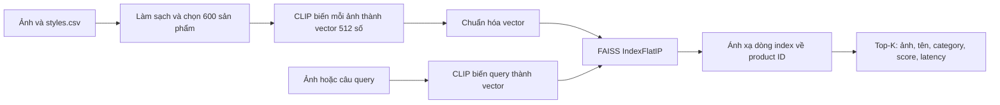

# Bàn giao cho thành viên — hiện trạng, cách baseline hoạt động và kế hoạch notebook

> Loại tài liệu: bản giải thích và bàn giao dễ đọc cho thành viên trong nhóm.
> Cập nhật: 19/09/2026.
> Trạng thái: phản ánh snapshot hiện có trong repository; không thay thế đề cương, Decision Register hoặc Research Protocol.

## 1. Đọc phần này trước nếu chỉ có 2 phút

Đồ án xây dựng hệ thống tìm kiếm sản phẩm thời trang bằng ba loại đầu vào:

1. một ảnh;
2. một câu mô tả tự nhiên, ưu tiên tiếng Việt;
3. một ảnh kèm yêu cầu thay đổi, ví dụ: “mẫu giống ảnh này nhưng màu xanh”.

Hiện tại nhóm **đã có search core chạy thật bằng Python**, chưa có website hoàn chỉnh:

- Dataset A đã được kiểm tra và làm sạch.
- Đã chọn catalog pilot 600 sản phẩm cân bằng.
- Model CLIP đóng băng đã biến 600 ảnh thành vector.
- FAISS đã lập chỉ mục và trả về Top-K sản phẩm gần nhất.
- Cả ba chế độ IMAGE, TEXT và COMPOSED đều chạy được.
- Có 24 pilot query, metric, latency, failure analysis và 14 automated tests.
- Week 4 đạt 13/14 gate; còn thiếu một thành viên khác chạy lại độc lập và ký xác nhận.

Việc gần nhất cần làm **không phải viết lại một baseline mới trong Colab**. Cần tạo notebook demo gọi lại cùng package `ai/ml/`, cùng config và cùng artifact. Notebook chỉ đảm nhiệm phần trình bày: chạy từng bước, hiện ảnh, Top-K, metric và failure case để GVHD dễ quan sát.

## 2. Phân biệt bốn thứ dễ bị nhầm

| Thành phần | Hiểu đơn giản | Hiện trạng |
|---|---|---|
| Search core | Bộ máy thực hiện encode, lập index, tìm kiếm và đánh giá | Đã có trong `ai/ml/retrieval/` |
| CLI | Cách điều khiển search core bằng câu lệnh Python | Đã có, chạy được nhưng output chủ yếu là JSON |
| Notebook | Giao diện trình diễn thí nghiệm theo từng cell, có ảnh và biểu đồ | Chưa có notebook chuẩn của repository |
| Website | Sản phẩm cuối cho người dùng, dùng Next.js + Spring Boot + AI service | Chưa triển khai |

Notebook không thay thế search core và cũng không phải website production. Nó là công cụ demo và nghiên cứu có thể chạy trên Colab.

Notebook `vocvanh` hiện có trên Google Drive là bản học/thử CLIP ban đầu. Notebook đó đã chứng minh được cách so sánh ảnh với câu tiếng Anh và hiển thị Top-5 trên một tập ảnh nhỏ, nhưng chưa phải nguồn kết quả chính thức vì chưa dùng pipeline 600 sản phẩm, chưa dùng FAISS thật, chưa có đủ ba mode và metric.

## 3. Hệ thống hiện hoạt động như thế nào?



Luồng đầy đủ gồm:

1. Đọc ảnh và `styles.csv`.
2. Ghép ảnh với metadata bằng product ID.
3. Báo ảnh thiếu, ảnh lỗi và metadata thiếu.
4. Chỉ giữ phạm vi Apparel và map về `TOP`, `BOTTOM`, `ONE_PIECE`.
5. Chọn 600 sản phẩm pilot bằng seed cố định.
6. Dùng CLIP sinh vector 512 chiều cho từng ảnh.
7. Chuẩn hóa vector và đưa vào FAISS.
8. Khi có query, sinh vector query theo đúng model/config.
9. FAISS tìm các vector gần query nhất.
10. Dùng row-to-product mapping để trả lại thông tin sản phẩm.

## 4. Embedding là gì?

Máy tính không hiểu trực tiếp rằng một ảnh là “áo xanh” hay “váy đỏ”. Model biến ảnh hoặc câu chữ thành một dãy số gọi là **embedding**.

Có thể tưởng tượng embedding giống một vị trí trên bản đồ:

- các sản phẩm có nội dung hoặc hình dáng gần nhau thường nằm gần nhau;
- query “blue shirt” được đặt lên cùng bản đồ;
- hệ thống tìm các điểm nằm gần query nhất.

Baseline hiện dùng vector 512 chiều. Con người không cần đọc ý nghĩa từng số. Điều cần kiểm tra là:

- mọi vector có đúng 512 số;
- không có giá trị `NaN` hoặc vô hạn;
- vector được chuẩn hóa về cùng thang đo;
- cùng input và cùng config cho kết quả ổn định.

Các kiểm tra trên đều đã pass trong snapshot hiện tại.

## 5. Chuẩn hóa L2 để làm gì?

Nếu hai vector có độ dài rất khác nhau, phép so sánh có thể bị ảnh hưởng bởi độ lớn thay vì hướng/ngữ nghĩa. Chuẩn hóa L2 đưa độ dài mỗi vector về gần 1.

Sau khi chuẩn hóa, tích vô hướng trong FAISS tương đương cách dùng cosine similarity cho baseline này. Có thể hiểu đơn giản: score càng cao thì query và sản phẩm càng gần nhau trên bản đồ embedding.

Snapshot hiện tại có norm từ `0.99999988` đến `1.00000012`, nằm trong tolerance.

## 6. FAISS và “cây chỉ mục” là gì?

FAISS là thư viện chuyên tìm các vector gần nhau. Nó không phải model AI và cũng không thay PostgreSQL.

Ví dụ đời thường:

- CLIP giống người chuyển mỗi sản phẩm thành tọa độ trên bản đồ.
- FAISS giống mục lục giúp tìm những tọa độ gần query.
- Row-to-product mapping giống bảng tra để biết tọa độ dòng 25 thực ra là sản phẩm nào.

Baseline dùng `IndexFlatIP`:

- `Flat` nghĩa là so query với toàn bộ 600 vector, không bỏ qua ứng viên nào;
- `IP` là inner product, dùng được như cosine similarity vì vector đã chuẩn hóa;
- đây là exact baseline, dễ kiểm tra và phù hợp catalog pilot 600 sản phẩm;
- khi catalog rất lớn mới cần cân nhắc index approximate nhanh hơn.

FAISS index hiện có 600 dòng. Test đã xác nhận mapping không lệch hàng và index được xây từ đúng catalog/model version.

## 7. Ba chế độ tìm kiếm hiện tại

### 7.1 IMAGE — tìm bằng ảnh

Ảnh query được CLIP biến thành vector rồi tìm các vector ảnh gần nhất.

Trong pilot evaluation, nếu ảnh query lấy từ catalog thì chính product đó bị loại khỏi kết quả. Vì vậy nhóm không dùng việc “tìm lại chính ảnh vừa đưa vào” để khoe độ chính xác.

### 7.2 TEXT — tìm bằng mô tả

Câu query được giữ thành hai phiên bản:

- raw text: đúng nội dung người dùng nhập;
- normalized model view: phiên bản đưa vào model.

Hệ thống nhận được Unicode tiếng Việt, kể cả có dấu, không dấu và một số câu colloquial. Tuy nhiên checkpoint hiện tại là CLIP tiếng Anh, nên “chạy được tiếng Việt” không đồng nghĩa “hiểu tiếng Việt tốt”. Đây là lý do tương lai cần so sánh với model multilingual/Vietnamese-capable trong RQ1.

### 7.3 COMPOSED — ảnh cộng mô tả thay đổi

Baseline kết hợp hai vector theo công thức:

```text
query = L2Norm(0.5 × image_embedding + 0.5 × text_embedding)
```

Nói đơn giản: hệ thống nghe ảnh 50% và câu chữ 50%. Đây chỉ là mốc so sánh ban đầu, chưa phải cơ chế fusion tối ưu hoặc adaptive.

## 8. Dataset và artifact hiện có

### 8.1 Dataset A

- Nguồn: `paramaggarwal/fashion-product-images-small`.
- Metadata ban đầu: 44.446 dòng.
- Unique image ID: 44.441.
- Ảnh thiếu: 5.
- Ảnh corrupt phát hiện trong lần audit: 0.
- Sản phẩm Apparel: 21.395.
- Sản phẩm thuộc phạm vi mapping MVP: 18.073.

### 8.2 Catalog pilot

Catalog dùng cho baseline gồm 600 sản phẩm:

| Category | Số lượng |
|---|---:|
| TOP | 200 |
| BOTTOM | 200 |
| ONE_PIECE | 200 |

Catalog SHA-256:

```text
82b21a099c92dbf42eca43475e6cea5459da3c3ff27fc528589ad85517f9da44
```

### 8.3 Model và index

| Thành phần | Phiên bản hiện tại |
|---|---|
| Model | `openai/clip-vit-base-patch32` |
| Exact revision | `092a3b7e31726acc3a0207eea00f6040ac8b03a7` |
| Embedding | 512 chiều, float32, L2-normalized |
| Index | `faiss-flatip-week4-v1`, `IndexFlatIP`, 600 dòng |
| Seed | 42 |

Raw dataset, model weights và secrets không được commit vào Git. Manifest/checksum được commit để người khác kiểm tra đúng phiên bản.

## 9. Metric là gì? Đọc số hiện tại như thế nào?

### 9.1 Precision@K

Trong K kết quả đã trả, có bao nhiêu kết quả được xem là liên quan?

Ví dụ Top-10 có 3 kết quả liên quan:

```text
Precision@10 = 3 / 10 = 0.3
```

### 9.2 Recall@K

Trong tất cả kết quả liên quan đã biết, Top-K tìm được bao nhiêu?

Ví dụ catalog có 20 kết quả được đánh dấu liên quan, Top-10 tìm được 3:

```text
Recall@10 = 3 / 20 = 0.15
```

Recall có thể thấp dù Top-10 trông hợp lý, vì chỉ được trả 10 kết quả trong khi weak label hiện tại có thể đánh dấu tới hàng trăm sản phẩm cùng category là liên quan.

### 9.3 TargetRecall@K

Mỗi pilot query có thể chỉ định một target cụ thể. Metric hỏi: target đó có xuất hiện trong Top-K không?

- Có: giá trị 1.
- Không: giá trị 0.
- Lấy trung bình trên các query.

TargetRecall hiện chỉ là diagnostic vì một query thời trang có thể có nhiều đáp án hợp lý, trong khi pilot chỉ chọn một designated target.

### 9.4 MRR

MRR thưởng cho việc kết quả liên quan đầu tiên xuất hiện sớm.

- Relevant đầu tiên ở hạng 1: điểm `1`.
- Ở hạng 2: điểm `1/2`.
- Ở hạng 5: điểm `1/5`.
- Không có trong Top-K: điểm `0`.

### 9.5 Latency p50 và p95

- p50: khoảng một nửa số query nhanh hơn con số này và một nửa chậm hơn.
- p95: 95% query nhanh hơn con số này; chỉ khoảng 5% chậm hơn.

Latency Week 4 là thời gian của Python/CLI trên máy thử nghiệm, **không phải latency website production**.

## 10. Kết quả pilot hiện tại

Có 24 pilot query:

- 12 TEXT;
- 6 IMAGE;
- 6 COMPOSED.

Kết quả tổng thể tại K=10:

| Metric | Giá trị |
|---|---:|
| Precision strict@10 | 0.0750 |
| Recall strict@10 | 0.0309 |
| TargetRecall@10 | 0.0833 |
| MRR strict@10 | 0.1651 |
| MRR relaxed@10 | 0.7778 |
| Latency p50 | 145.75 ms |
| Latency p95 | 562.44 ms |

Không nên đọc bảng trên thành “model chỉ chính xác 7,5%”. Nhãn hiện tại là weak label sinh từ metadata, không phải đánh giá Gold của người chấm. Pilot này chủ yếu trả lời ba câu:

1. pipeline từ dataset đến Top-K có chạy xuyên suốt không;
2. metric có tính và xuất được không;
3. failure nào cần điều tra trước giai đoạn nghiên cứu chính thức.

Mọi query và report đều được gắn `pilot_only: true`. Chưa có final-test claim.

## 11. Những gì đã pass và những gì chưa xong

### Đã hoàn thành

- Dataset manifest và cleaning report.
- Catalog pilot 600 sản phẩm cân bằng.
- Frozen CLIP encoder và model manifest.
- 600 embedding thật, không NaN, đúng dimension và norm.
- FAISS index và row-to-product mapping.
- IMAGE, TEXT và COMPOSED search.
- 24 pilot query.
- Precision, Recall, TargetRecall, MRR và latency.
- Per-query output và năm failure case.
- 14 automated tests và CPU smoke test.
- Dependency lock, config, seed, checksum và artifact version.
- Hướng dẫn local CPU và Colab T4.

### Chưa hoàn thành

- Chưa có independent rerun có chữ ký từ một thành viên khác; Week 4 đang ở 13/14 gate.
- Chưa có notebook chuẩn gọi trực tiếp search core của repository.
- Chưa có Vietnamese Gold benchmark hoặc human judgment chính thức.
- Chưa có multilingual challenger được chọn và chạy theo RQ1.
- Chưa audit product-group/pHash dedupe đầy đủ cho Phase 2.
- Chưa có website Next.js, Spring Boot API hoặc FastAPI adapter hoàn chỉnh.
- Chưa bắt đầu fine-tuning, RQ1–RQ3 hoặc final test.

## 12. Vì sao cần làm notebook tiếp theo?

CLI tốt cho tính tái lập nhưng khó demo vì output là JSON và đường dẫn ảnh. Notebook phù hợp với GVHD hơn vì có thể trình bày tuần tự:

- catalog có bao nhiêu sản phẩm;
- ảnh query là gì;
- Top-5 gồm những ảnh nào;
- score và latency bao nhiêu;
- query tốt và query thất bại khác nhau ra sao;
- metric tổng hợp được tính từ đâu.

Notebook phải là **adapter trình bày**, không chứa một bản copy khác của thuật toán. Nếu sửa công thức search ở hai nơi, sớm muộn kết quả CLI và Colab sẽ khác nhau.

## 13. Thiết kế notebook baseline tiếp theo

Tên file đề xuất:

```text
notebooks/week4_baseline_demo.ipynb
```

Notebook nên có các phần/cell sau:

| Phần | Nội dung | Output cần nhìn thấy |
|---:|---|---|
| 0 | Mục tiêu và cảnh báo `PILOT_ONLY` | Scope rõ ràng |
| 1 | Mount Drive hoặc clone/copy repository | Đường dẫn project |
| 2 | Cài đúng `ai/requirements.lock` | Phiên bản Python, Torch, Transformers, FAISS |
| 3 | Chọn CPU hoặc T4 | Device, precision và artifact ID riêng |
| 4 | Kiểm tra dataset/artifact | Manifest, checksum, 600 sản phẩm |
| 5 | Dataset overview | Category counts và sample gallery |
| 6 | Model health | Dimension, NaN check, norm range, revision |
| 7 | Text search demo | Raw Vietnamese query và Top-5 ảnh |
| 8 | Image search demo | Ảnh query, loại self-product, Top-5 ảnh |
| 9 | Composed search demo | Ảnh + câu sửa đổi + Top-5 |
| 10 | Pilot evaluation | Metric tổng thể, theo mode và latency |
| 11 | Success/failure cases | Ít nhất một trường hợp tốt và một thất bại |
| 12 | Export evidence | Tải report/manifest cần bàn giao |

Notebook nên gọi các hàm trong `ml.retrieval` hoặc CLI hiện tại. Không tự viết lại vòng encode, công thức fusion, metric hoặc FAISS mapping trong cell.

## 14. Quy tắc bắt buộc cho notebook

1. Pin đúng model revision, preprocessing và dependency.
2. Ghi rõ device, precision, batch size và seed.
3. Không để Kaggle token hoặc secret trong cell/output.
4. Không đưa raw dataset hoặc model weights vào Git.
5. T4/float16 phải tạo model/index version riêng; không giả vờ cùng hash với CPU/float32.
6. Query demo vẫn là pilot, không gọi là final benchmark.
7. Image query lấy từ catalog phải loại chính product khỏi kết quả đánh giá.
8. Không dùng nguyên `productDisplayName` làm query rồi che title leakage.
9. FAISS mapping và manifest phải được verify trước khi search.
10. Chạy `Restart session and run all` trước khi bàn giao để tránh output cũ hoặc biến còn sót.

## 15. Cách chạy baseline hiện tại

### Kiểm tra nhanh, không cần model thật

```bash
cd "/Users/khoado/Documents/ChatGPT/Graduate Bachelor"
./scripts/run_cpu_smoke.sh
```

Kỳ vọng: 14 tests pass, smoke status `PASS`. Fixture chỉ kiểm tra plumbing, không chứng minh chất lượng model.

### Chạy toàn bộ baseline thật

```bash
./scripts/run_week4_baseline.sh
```

Script lần lượt prepare catalog, encode ảnh, build FAISS index, chạy 24 pilot query và verify provenance.

### Chạy một text query

```bash
.venv/bin/python -m ml.retrieval.cli search \
  --encoder hf_clip \
  --mode text \
  --text "áo xanh mặc hằng ngày" \
  --top-k 10
```

### Chạy image query và loại chính ảnh query

```bash
.venv/bin/python -m ml.retrieval.cli search \
  --encoder hf_clip \
  --mode image \
  --image "/absolute/path/to/query.jpg" \
  --exclude-product-id PRODUCT_ID \
  --top-k 10
```

### Kiểm tra artifact

```bash
.venv/bin/python scripts/verify_week4_artifacts.py
```

Kỳ vọng của snapshot hiện tại:

```text
status = PASS
rows = 600
dimension = 512
model_version = openai/clip-vit-base-patch32@092a3b7e3172+a6a0317b924b
index_version = faiss-flatip-week4-v1
```

## 16. File nào quan trọng cho teammate?

| Muốn tìm | File/thư mục |
|---|---|
| Code pipeline | `ai/ml/retrieval/` |
| Config baseline | `ai/configs/baseline.v1.yaml` |
| Config metric | `ai/configs/evaluation.v1.yaml` |
| Pilot query | `evaluation/pilot_queries.dataset_a.v1.jsonl` |
| Script chạy end-to-end | `ai/scripts/run_week4_baseline.sh` |
| Test | `tests/` |
| Catalog đã làm sạch | `ai/data/processed/catalog-20260908-pilot-v1/` |
| Model/embedding manifest | `ai/artifacts/embeddings/week4-baseline-20260908-v1/` |
| FAISS/index mapping | `ai/artifacts/indexes/week4-baseline-20260908-v1/` |
| Metric/per-query report | `ai/artifacts/reports/week4-baseline-20260908-v1/` |
| Báo cáo dễ đọc | `docs/week4/WEEK4_PILOT_REPORT.v1.md` |
| Hướng dẫn chạy | `docs/week4/WEEK4_BASELINE_RUNBOOK.md` |
| Phiếu independent rerun | `docs/week4/WEEK4_INDEPENDENT_RERUN.md` |

## 17. Kế hoạch tiếp theo theo thứ tự ưu tiên

### Ưu tiên 1 — Notebook baseline demo

- Tạo notebook chuẩn trong repository.
- Dùng lại core package và artifact versioned.
- Hiển thị Top-5 bằng ảnh cho đủ ba mode.
- Hiển thị metric, latency và failure case.
- Chạy sạch từ đầu đến cuối trên Colab T4.
- Xuất manifest/report của lần chạy notebook.

Definition of Done: một teammate mở notebook mới, làm theo hướng dẫn và demo được mà không sửa code trong cell.

### Ưu tiên 2 — Đóng Week 4 Gate

- Một thành viên khác chạy smoke test và baseline theo runbook.
- So catalog hash, model revision, config hash và index hash.
- Ghi khác biệt nếu CPU/runtime khác.
- Ký `WEEK4_INDEPENDENT_RERUN.md`.
- Chỉ sau đó cập nhật Gate từ 13/14 thành 14/14.

### Ưu tiên 3 — Phase 2 Data Foundation

- Audit duplicate bằng exact checksum và pHash.
- Tạo `product_group` để các biến thể cùng mẫu không lọt qua train/test.
- Freeze catalog/split có manifest.
- Pilot annotation với người chấm.
- Bắt đầu xây query/intent tiếng Việt Gold.

### Ưu tiên 4 — RQ1 Vietnamese adaptation

- Chọn và pin một multilingual/Vietnamese-capable challenger.
- So sánh công bằng với frozen CLIP baseline trên cùng catalog/query protocol.
- Không chọn model bằng final test.
- Chỉ fine-tune sau khi dữ liệu, split và evaluation protocol đủ điều kiện.

### Luồng Web có thể chạy song song

- Next.js + TypeScript: giao diện website.
- Java Spring Boot: business/public API và PostgreSQL ownership.
- Python/FastAPI: adapter nội bộ gọi search core.
- Mobile chỉ xem xét sau website/search core, kiểm thử, triển khai và báo cáo.

Không cần chờ toàn bộ nghiên cứu AI xong mới dựng skeleton Web/API, nhưng website không được trở thành lý do trì hoãn notebook, metric hoặc data governance.

## 18. Những việc chưa nên làm

- Không fine-tune model lớn chỉ để metric pilot đẹp hơn.
- Không dùng notebook cũ làm nguồn sự thật thay repository.
- Không copy code search sang nhiều notebook.
- Không mở final test để chọn model hoặc sửa prompt.
- Không gọi self-retrieval là retrieval accuracy.
- Không xây mobile, VTON, 3D, outfit compatibility hoặc full e-commerce lúc này.
- Không báo latency CLI là latency website.
- Không kết luận model tốt/xấu chỉ từ weak-label pilot metric.

## 19. Cách một teammate mới bắt đầu trong 30 phút

1. Đọc mục 1 đến 11 của file này.
2. Mở `docs/week4/WEEK4_PILOT_REPORT.v1.md` để xem số liệu và failure case.
3. Chạy `./scripts/run_cpu_smoke.sh`.
4. Mở sample gallery ở `ai/data/processed/catalog-20260908-pilot-v1/sample-gallery.v1.html`.
5. Chạy một IMAGE query và một TEXT query.
6. Đọc `docs/week4/WEEK4_INDEPENDENT_RERUN.md` nếu là người xác nhận Gate.
7. Khi làm notebook, chỉ gọi lại `ai/ml/retrieval/`; không viết lại thuật toán trong cell.

## 20. Một câu dùng để thống nhất trong nhóm

> Nhóm đã hoàn thành một frozen multimodal retrieval baseline chạy xuyên suốt trên catalog pilot 600 sản phẩm, có ba mode, FAISS, metric và provenance; bước kế tiếp là đóng gói chính baseline đó vào notebook Colab để demo và tái lập, sau đó đóng independent rerun rồi chuyển sang Data Foundation và RQ1 tiếng Việt.
